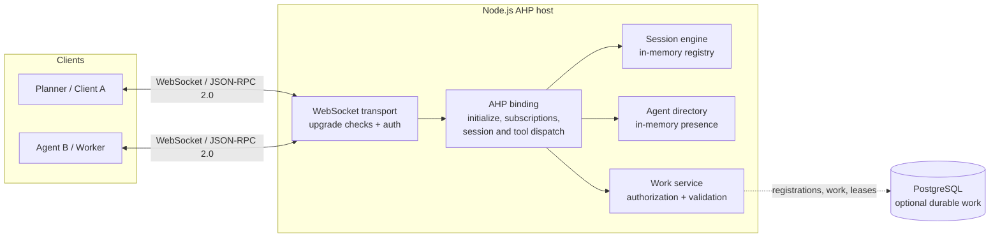
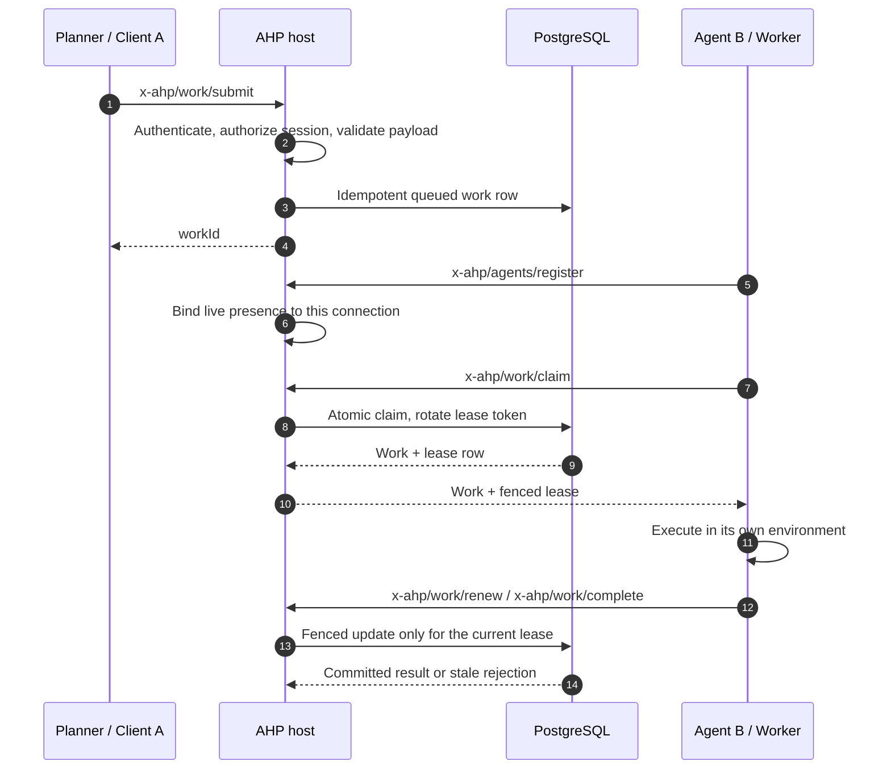

# Agent Hosting Protocol

An AHP host: a server that hosts agent sessions and speaks the
[Agent Hosting Protocol](https://github.com/spore310/AHP) to clients over a
WebSocket JSON-RPC 2.0 transport.

The repository is a capability-oriented modular monolith. See
[`.agents/AGENTS.md`](.agents/AGENTS.md) for repository-wide invariants and
[`docs/CodingRules.md`](docs/CodingRules.md) for coding conventions.

## Status

**Working POC, not a complete AHP endpoint.** The default host uses an in-memory
mock provider; it does not run a model or execute agent work server-side.

Implemented today:

- [`src/jsonrpc/`](src/jsonrpc/README.md) — JSON-RPC 2.0 schemas, the owned
  `RpcError`, and the allowlisted wire errors.
- [`src/sessions/`](src/sessions/README.md) — the session engine: provider
  registry, in-memory store, sequence allocation, initialization,
  subscriptions, session creation/disposal/listing, and baseline actions.
- [`src/websocket/`](src/websocket/README.md) — WebSocket transport, the AHP
  binding, client-to-client `x-ahp/tools/*` invocation, and the composed host.
- [`src/application/`](src/application/README.md) and
  [`src/toolClient/`](src/toolClient/README.md) — baseline `code-review` /
  `coding` policy and the public SDK adapter.
- [`src/agents/`](src/agents/README.md) — optional static bearer authentication,
  durable agent registration, and in-memory generation-fenced presence.
- [`src/persistence/`](src/persistence/README.md) and
  [`src/work/`](src/work/README.md) — shared persistence contracts with an
  allowlisted PostgreSQL adapter, plus work authorization and validation.
- [`env/`](env/README.md) — validated process configuration.

The authenticated agent/work extension is opt-in. Without both a database URL
and an auth-token map it is not registered and no provider is selected; the
baseline host is unchanged. A configured provider name is resolved by the
adapter registry, which currently defaults to PostgreSQL.

Not implemented yet: production identity/OIDC, real chat/turn execution,
reconnect/replay, workflow scheduling, cross-principal grants, and server-side
model or filesystem execution. Planned milestones are in
[`docs/plans/ProvidersPlan.md`](docs/plans/ProvidersPlan.md).

### Verification status

`pnpm validate` is the repository gate. Unit and protocol tests cover the
baseline and the agent/work service. The PostgreSQL migration scripts were
**written but deliberately not applied** at the user's instruction, so SQL and
real-database acceptance remain **BLOCKED**, not passed. See
[`database/migrations/README.md`](database/migrations/README.md).

## How AHP composes



The live session, sockets, subscriptions, and agent presence are memory-only.
PostgreSQL is the optional source of truth for agent registrations and durable
work. A database row never stands in for a live WebSocket.

## Request flow

```mermaid
sequenceDiagram
    autonumber
    participant C as Client
    participant T as WebSocket transport
    participant H as AHP binding
    participant S as Session engine

    C->>T: JSON-RPC request or notification
    T->>T: Validate frame and attach handshake principal
    T->>H: Dispatch (serialized per connection)
    H->>H: Require initialized; enforce request/notification kind
    H->>S: Create, subscribe, dispatch action, or invoke tool
    S-->>H: Snapshot, result, or action envelopes
    H-->>T: JSON-RPC response / subscription notifications
    T-->>C: Text frames
```

The binding publishes only after a subscription is settled and drops events that
arrive while a snapshot reply is pending. Tool calls are short-lived
client-to-client requests; durable work is a separate extension.

## Agent work lifecycle



Claiming is explicit; v1 sends no work-available push. Any future push hint is
never proof of assignment. A worker must claim durable work; an expired lease can
be reclaimed with a new token and attempt. Full failure cases, security caveats,
and the state machine are in
[`docs/architecture/agent-task-lifecycle.md`](docs/architecture/agent-task-lifecycle.md).

## Requirements

- Node.js 24.x
- pnpm 10.34.6
- PostgreSQL 17 (only for the optional durable extension; migrations are not
  applied by this repository's default start)

## Install and run

```sh
pnpm install
pnpm build
pnpm start
```

`pnpm start` runs the built entrypoint at `dist/index.js`. The default host uses
the mock session provider and does not need a database.

## Environment variables

Configuration is validated before the server starts; see
[`env/README.md`](env/README.md).

| Variable | Default | Meaning |
| --- | --- | --- |
| `AGENT_HOSTING_PROTOCOL_WEBSOCKET_HOST` | `127.0.0.1` | Network interface to bind. |
| `AGENT_HOSTING_PROTOCOL_WEBSOCKET_PORT` | `12345` | TCP port to bind (1–65535). |
| `AGENT_HOSTING_PROTOCOL_DATABASE_URL` | unset | PostgreSQL URL. Required with auth tokens to enable the extension. |
| `AGENT_HOSTING_PROTOCOL_AUTH_TOKENS` | unset | JSON object mapping bearer tokens to principal subjects. Never log it. |
| `AGENT_HOSTING_PROTOCOL_PRESENCE_TTL_SECONDS` | `90` | In-memory presence lifetime. |
| `AGENT_HOSTING_PROTOCOL_WORK_LEASE_SECONDS` | `60` | Work lease lifetime, evaluated by the database clock. |
| `AGENT_HOSTING_PROTOCOL_ALLOWED_WORK_KINDS` | `code.patch,code.review` | Comma-separated work kinds accepted by the extension. |

Supplying only one of `DATABASE_URL` / `AUTH_TOKENS` is a startup error. Unknown
environment variables are ignored. Invalid values name the offending keys only,
never their values.

## Wire behavior

The server accepts WebSocket upgrades on `/` and speaks JSON-RPC 2.0 over text
frames. Ordinary HTTP requests receive `426 Upgrade Required`. Malformed upgrade
targets are rejected without affecting the running server. When authentication
is enabled, the upgrade may carry `Authorization: Bearer <token>`.

Baseline request methods include `initialize`, `ping`, `subscribe`,
`createSession`, `disposeSession`, `listSessions`, and `x-ahp/tools/call`.
Notifications include `unsubscribe`, `dispatchAction`, and
`x-ahp/tools/complete`. The optional extension adds `x-ahp/agents/*` and
`x-ahp/work/*`.

Example exchange (the connection must be initialized first):

```json
{ "jsonrpc": "2.0", "id": 1, "method": "initialize", "params": { "channel": "ahp-root://", "clientId": "example", "protocolVersions": ["1.0.0"] } }
{ "jsonrpc": "2.0", "id": 1, "result": { "protocolVersion": "1.0.0" } }
{ "jsonrpc": "2.0", "id": 2, "method": "ping", "params": { "channel": "ahp-root://" } }
{ "jsonrpc": "2.0", "id": 2, "result": null }
```

`initialize.clientId` is a client label, never an authenticated identity.
Principal identity comes only from the upgrade handshake. See
[`docs/technical/wire-contract.md`](docs/technical/wire-contract.md).

## Development

```sh
pnpm lint         # ESLint
pnpm typecheck    # tsc --noEmit
pnpm test         # Vitest
pnpm docs:check   # documentation coverage gate
pnpm validate     # lint, typecheck, test, docs:check, build — run before completing a change
```

Module documentation is required: every `src/` and `env/` source file must be
mapped by its module `README.md`. See
[`docs/gates/documentation.md`](docs/gates/documentation.md).

## Documentation map

- [`src/README.md`](src/README.md) — capability map and composition root.
- [`docs/architecture/capabilities.md`](docs/architecture/capabilities.md) —
  dependency direction and runtime ownership.
- [`docs/architecture/agent-task-lifecycle.md`](docs/architecture/agent-task-lifecycle.md)
  — identity, presence, work leases, sequence diagram, and failure cases.
- [`database/M2_AGENT_WORK_DATABASE_SCHEMA.md`](database/M2_AGENT_WORK_DATABASE_SCHEMA.md)
  — ERD, work table invariants, and state machine.
- [`docs/technical/wire-contract.md`](docs/technical/wire-contract.md) and
  [`docs/technical/runtime-lifecycles.md`](docs/technical/runtime-lifecycles.md)
  — wire and lifecycle details.
