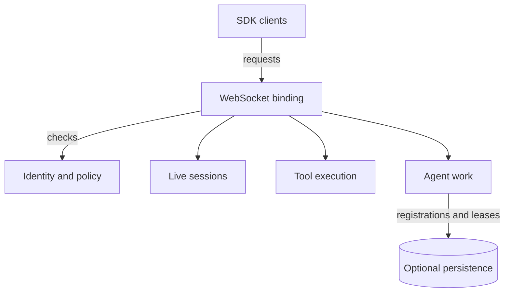

# Agent Hosting Protocol host

A TypeScript host for agent sessions over WebSocket and JSON-RPC. An
embedding application supplies providers, identity, and policy. Clients connect
through the AHP SDK. The host owns session state, authorization, and delivery.

## Use the SDK

- [Five-minute quick start](docs/guides/quickstart.md) · Start a local host and create a typed session that reaches `ready`.
- [Advanced review application](docs/guides/advanced.md) · Run authenticated clients, protected tools, artifact delivery, and agent registration on one loopback host.
- [Wire contract](docs/technical/wire-contract.md) · Check which messages belong to AHP and which belong to this host's extensions.

## Contribute to AHP

- [Capability map](docs/architecture/capabilities.md) · Find the module that owns the behavior you want to change.
- [Runtime lifecycles](docs/technical/runtime-lifecycles.md) · Follow session creation, sequencing, work, and shutdown.
- [Validation](docs/gates/documentation.md) and [coding rules](docs/CodingRules.md) · Check the repository before handing off a change.

## How the host fits together



Clients see an authorized view of the host's state. Optional persistence holds
registrations and work leases. Live sessions, sockets, and presence stay in memory.

## Requirements

Use Node.js 24 and pnpm 10.34.6. The examples run locally without a database or a
model account. The [PostgreSQL guide](docs/guides/postgresql.md) covers the opt-in
adapter and its verification scope.

## Install and run

```sh
pnpm install
pnpm exec vite-node examples/quickstart.ts
```

The quick start prints a loopback address and a ready session, then exits.
`pnpm build` followed by `pnpm start` runs the repository entrypoint with its
mock provider. Use the SDK examples to see the composed application APIs and
security configuration. The default CLI configuration opens a listener and leaves
the protected SDK paths gated by the embedding application's security setup.
[CLI configuration](env/README.md)

## Development

```sh
pnpm validate
```

Validation runs lint, typecheck, tests, documentation coverage, and the production
build. The suite has real loopback SDK tests for protected sessions and tool
execution. The PostgreSQL adapter has offline checks and a separate, opt-in
database conformance runner. [Verification guide](docs/README.md#verification)

## Documentation map

- [Documentation index](docs/README.md) · Current guides by task.
- [Source modules](src/README.md) · Public entrypoints and owning READMEs.
- [Active plans](docs/plans/README.md) · Proposed work and accepted direction.
- [Archive](docs/archive/README.md) · Completed plans, reviews, and recorded validation.
- [Repository instructions](.agents/AGENTS.md) · Architecture and engineering conventions.
