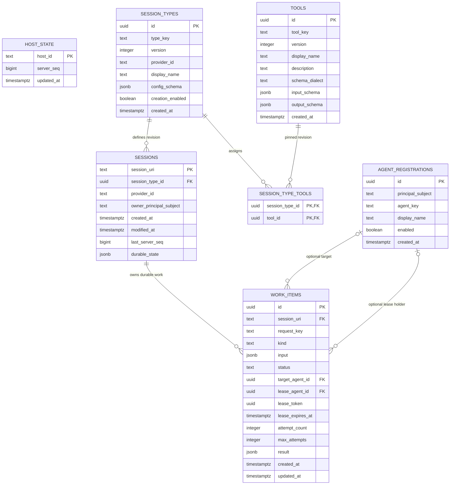
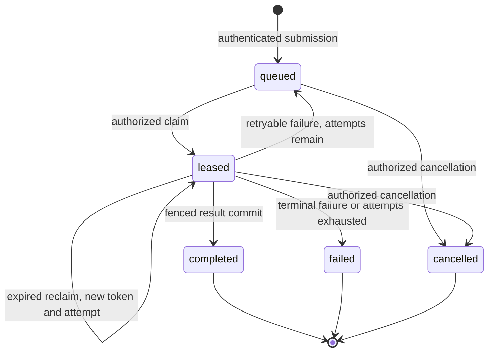

# Agent Registration and Work-Lease Schema

> **Status:** DDL written, not applied. This document describes the PostgreSQL
> schema in [`database/migrations/`](migrations/). The user instructed that the
> scripts must not be executed yet, so no migration or database test has run.

PostgreSQL is the POC's proposed durable dialect. The executable SQL is
authoritative over this prose. The broader design rationale remains in
[`docs/plans/agent tasks and identity/M2_AGENT_WORK_DATABASE_SCHEMA.md`](../docs/plans/agent%20tasks%20and%20identity/M2_AGENT_WORK_DATABASE_SCHEMA.md);
this page records the implemented shape and its invariants.

## Entity relationship diagram



`host_state` is a checkpoint and is not a foreign-key parent of `sessions`.
`session_types.provider_id` points at provider code registered in the
application, not another table. The two `agent_registrations` relationships are
different: `target_agent_id` is the intended worker, while `lease_agent_id` is
the current execution-rights holder.

## What is durable and what is not

| Concept | Durable table | Notes |
| --- | --- | --- |
| Agent registration | `agent_registrations` | Survives disconnect, restart, and reauthentication. `enabled` is administrative state, not presence. |
| Work item and current lease | `work_items` | One row per durable task; the current token and deadline are columns. |
| Session owner and durable projection | `sessions.owner_principal_subject` + state columns | Owner comes only from authenticated server context. |
| Live agent presence | **none** | In-memory `AgentDirectory`, default 90 s TTL, generation-fenced. |
| Sockets, subscriptions, active clients | **none** | Runtime-only; never authoritative for work. |
| Session options and pinned tools | `session_types`, `tools`, `session_type_tools` | Baseline exact-revision model. |

Do **not** add a SQL `agent_leases` or `session_active_clients` table for this
slice. A database row cannot prove that a WebSocket is alive, and a WebSocket
heartbeat cannot prove agent identity.

## Work columns and invariants

| Column | Type / default | Invariant |
| --- | --- | --- |
| `id` | `UUID PRIMARY KEY DEFAULT gen_random_uuid()` | Stable work identity across retries. |
| `session_uri` | `TEXT NOT NULL REFERENCES sessions` | `ON DELETE RESTRICT`; disposal is blocked while any work exists. |
| `request_key` | `TEXT NOT NULL` | Unique with `session_uri`; 1–256 chars; idempotency key. |
| `kind` | `TEXT NOT NULL` | 1–128 chars; additionally allowlisted by the service. |
| `input` | `JSONB NOT NULL` | Must be a JSON object; bounded by the wire/service layer. |
| `status` | `TEXT NOT NULL DEFAULT 'queued'` | One of `queued`, `leased`, `completed`, `failed`, `cancelled`. |
| `target_agent_id` | `UUID NULL` | Optional intended agent; must belong to the session owner. The DDL cannot express this across tables — the FK only anchors the row — so the invariant is enforced at write time by `WorkService.submit` (`src/work/helpers/helpers.ts`), not by the schema. Direct repository callers bypass the service check. |
| `lease_agent_id` | `UUID NULL` | Current holder only while `leased`. |
| `lease_token` | `UUID NULL` | Rotated on every claim/reclaim; sensitive; never returned by `get`. |
| `lease_expires_at` | `TIMESTAMPTZ NULL` | Evaluated with the database clock, never the process clock. |
| `attempt_count` | `INTEGER NOT NULL DEFAULT 0` | Incremented atomically on claim; never exceeds `max_attempts`. |
| `max_attempts` | `INTEGER NOT NULL DEFAULT 3` | Positive; retry budget. |
| `result` | `JSONB NULL` | Must be a JSON object when present; terminal result only. |
| `created_at`, `updated_at` | `TIMESTAMPTZ NOT NULL DEFAULT now()` | Updated with `statement_timestamp()` on lease changes. |

The schema enforces lease-shape consistency:

```sql
CHECK (
  (status = 'leased') =
    (lease_agent_id IS NOT NULL
     AND lease_token IS NOT NULL
     AND lease_expires_at IS NOT NULL)
)
```

It also enforces `attempt_count <= max_attempts`, `jsonb_typeof(input) = 'object'`,
and `result IS NULL OR jsonb_typeof(result) = 'object'`.

## Indexes

- `work_items_queued_claim_idx` on `(session_uri, created_at, id)` where
  `status = 'queued'`.
- `work_items_expired_claim_idx` on
  `(session_uri, lease_expires_at, created_at, id)` where `status = 'leased'`.
- `work_items_session_idx` on `(session_uri, created_at DESC)` for dependent-work
  and listing checks.
- `UNIQUE (session_uri, request_key)` for idempotent submission.
- `UNIQUE (principal_subject, agent_key)` for stable registration.

## Claim and fencing rules

Claims select one eligible row under `FOR UPDATE ... SKIP LOCKED`. A row is
eligible when it is `queued`, or `leased` with an expired deadline, and
`attempt_count < max_attempts`. The update:

1. sets `status = 'leased'`;
2. sets `lease_agent_id` to the caller;
3. rotates `lease_token = gen_random_uuid()`;
4. sets `lease_expires_at = statement_timestamp() + ttl`;
5. increments `attempt_count`; and
6. updates `updated_at`.

Renew, complete, and fail all require the current token, the same enabled agent,
the same unexpired deadline, and a session owned by the agent's principal.
Completion additionally writes the bounded result. A mismatch updates zero rows;
it is treated as stale/unauthorized rather than overwriting newer work.

`reconcileExpired` terminalizes only expired `leased` rows whose attempt budget is
exhausted. Expired rows with budget left remain eligible for a later atomic
reclaim with a new token.

## State machine



## Operational caveats

- Apply `0001` then `0002` to an empty database only after approval. There is no
  automatic rollback for durable work.
- The adapter uses `statement_timestamp()` for leases. Do not compare deadlines
  with a Node clock.
- A work row is a coordination record, not proof of side effects. Execution is
  at-least-once across expiry/restart; artifacts need isolation and independent
  evaluation before promotion.
- No background scheduler is included. Claim selects expired rows; callers may
  invoke reconciliation.
- No cross-principal grant model exists yet. Targeted work must be for the same
  principal as the session owner; that invariant is enforced by
  `WorkService.submit` at write time, not by this DDL (an FK cannot express it
  across tables).
- A submission whose repository write settles after its live session was
  disposed is reconciled, not orphaned: the work service cancels the row and
  reports a conflict to the caller.

## Related documentation

- [`database/migrations/README.md`](migrations/README.md) — apply order and
  current no-apply status.
- [`docs/architecture/agent-task-lifecycle.md`](../docs/architecture/agent-task-lifecycle.md)
  — end-to-end sequence and failure cases.
- [`src/persistence/README.md`](../src/persistence/README.md) — adapter behavior.
