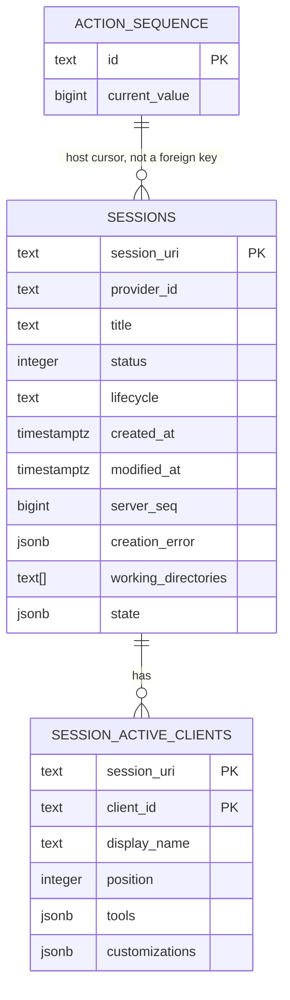
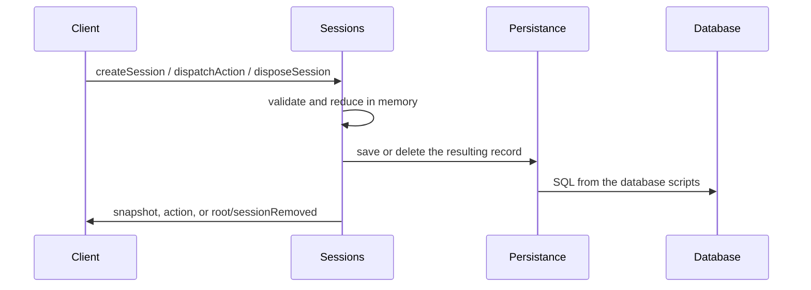

# Session tables

Status: **Superseded.** The shipped schema is
`database/migrations/0001_session_tool_baseline.sql` with the durable
session shape documented in
[`database/M2_AGENT_WORK_DATABASE_SCHEMA.md`](M2_AGENT_WORK_DATABASE_SCHEMA.md):
`owner_principal_subject` ownership, `last_server_seq`, and a JSONB
`durable_state` projection. The `title/status/lifecycle/state` shape proposed
here — along with `action_sequence` and `session_active_clients` — was superseded
by those shipped migrations and was never implemented as specified. Read this
file only as the original proposal record; the executable SQL and
`src/persistence/helpers/sessions.ts` are authoritative. Behavioral statements
inside the body — including "disposed sessions are deleted" — describe the
original proposal: shipped behavior keeps durable rows, with retention
explicitly deferred — the retain/cancel-and-archive policy is recorded as
"not implemented" in
[`docs/architecture/agent-task-lifecycle.md`](../docs/architecture/agent-task-lifecycle.md).

This document is the table design for storing a session as the server holds it today. When scripts are added, the raw SQL in `database/` is authoritative. `src/persistance/` may use Drizzle, Prisma, or another client, but it must follow these tables. It must not invent a second schema.

Assumed script dialect: PostgreSQL. That is not an established product decision. If the engine changes, change the scripts first and then this document.

## What is stored

A durable session is the current `SessionRecord` minus live handles.

Stored:

- session URI
- provider id string
- `createdAt`, `modifiedAt`
- the record's last `serverSeq`
- the reducer-owned `SessionState` needed to rebuild a snapshot and a catalogue summary

Not stored:

- the `SessionProvider` object
- the `SessionBackend` handle (`dispose()` is a function, not data)
- sockets, subscriptions, or negotiated `clientId`s
- the host action-sequence cursor is stored separately, because it is not a column of one session

Disposed sessions are deleted. That matches `disposeSession`, which removes the record from the registry. This design is not a replay journal.

## Diagrams

### Ownership

```text
database/*.sql          authoritative tables and constraints
        |
        v
src/persistance/        application read/write adapter
        |
        v
src/sessions/           still owns validation, reducer, and catalogue events
```

The persistence adapter loads and saves rows. It does not apply `sessionReducer`, mint sequence numbers, or decide who may dispose a session.

### Tables



### Write path



A database failure must not be reported as a successful protocol mutation. The sessions module remains the authority for the protocol result. Persistence is the durability step for that result.

## `action_sequence`

One row for the host cursor. Restoring sessions without it would let new actions reuse old `serverSeq` values.

| Column | Type | Notes |
| --- | --- | --- |
| `id` | `text` primary key | Fixed value `host`. |
| `current_value` | `bigint` not null | Last allocated sequence. `0` before any action. Matches `ActionSequence.current()`. |

This table does not store events. Milestone 5 replay is out of scope.

## `sessions`

One row per non-disposed session. Primary key is the protocol URI, for example `ahp-session:/example`.

| Column | Type | Notes |
| --- | --- | --- |
| `session_uri` | `text` primary key | Client-chosen. Must match `ahp-session:/` plus a non-empty id. |
| `provider_id` | `text` not null | `SessionState.provider`. Not a foreign key. Providers stay in code. |
| `title` | `text` not null | Catalogue field. Default in code is `New Session`. |
| `status` | `integer` not null | Protocol `SessionStatus`, including the read and archived flags. |
| `lifecycle` | `text` not null | `creating`, `ready`, or `creationFailed`. |
| `created_at` | `timestamptz` not null | From the record. Not updated. |
| `modified_at` | `timestamptz` not null | Advances when an accepted action is applied. `listSessions` orders by this, then URI. |
| `server_seq` | `bigint` not null | Last sequence on this record. `0` before any action. |
| `creation_error` | `jsonb` null | `errorType` and `message` only when lifecycle is `creationFailed`. No stack. |
| `working_directories` | `text[]` null | Present when `createSession` supplied directories. Empty means absent, not an empty grant. |
| `state` | `jsonb` not null | Full `SessionState` after the reducer. Rebuild source if a column and the document disagree. |

Indexed for the current catalogue:

- `(modified_at desc, session_uri)` for `listSessions`
- `(provider_id)` so a host can find sessions for one provider

`state` is required even though some fields are also columns. The reducer can set fields this server does not yet treat as first-class, including `activity`, `config`, `chats`, and `customizations`. Those stay inside `state` until a later milestone needs its own table. The columns above are the fields this server already uses for snapshots and `listSessions`.

On `disposeSession`, delete the session row. Child client rows go with it.

## `session_active_clients`

One row per client in `SessionState.activeClients`. This is the membership `session/activeClientSet` and `session/activeClientRemoved` already change.

| Column | Type | Notes |
| --- | --- | --- |
| `session_uri` | `text` not null | References `sessions.session_uri`. Delete with the session. |
| `client_id` | `text` not null | Matches the negotiated connection `clientId` when a client registers itself. |
| `display_name` | `text` null | Optional protocol display name. |
| `position` | `integer` not null | Order in the protocol array. A second set for the same `client_id` updates the row. It does not insert a duplicate. |
| `tools` | `jsonb` not null | The client's `ToolDefinition` array. Default `[]`. |
| `customizations` | `jsonb` not null | The client's plugin customizations. Default `[]`. |

Primary key: `(session_uri, client_id)`.

Tools and customizations stay JSON. This server stores them and returns them on a snapshot. It does not run tools or expand plugins, so separate tool and plugin tables would invent a model the code does not have.

A remove for an unknown `client_id` changes nothing. A remove for a known `client_id` deletes that row and updates `sessions.modified_at` and `sessions.server_seq` only when the reducer applies an accepted action. The current factory emits that accepted action even when the reducer leaves the set unchanged. The persistence adapter must save the record the factory returns, not invent a second no-op rule.

## What a reload must produce

Loading these tables must be enough to build:

- `getSessionSnapshot`
- `listSessions`
- `listSessionSnapshots` for the root `activeSessions` count
- the next host sequence value, from `action_sequence.current_value`

It must not recreate sockets, subscriptions, or backend handles. After a restart, `activeClients` can still list a `client_id` whose socket is gone. That matches current code: disconnect does not remove an active client.

## Out of scope

- connection and subscription tables
- users, principals, or leases
- action history or replay
- chat, terminal, MCP, and working-directory enforcement tables
- a `providers` table
