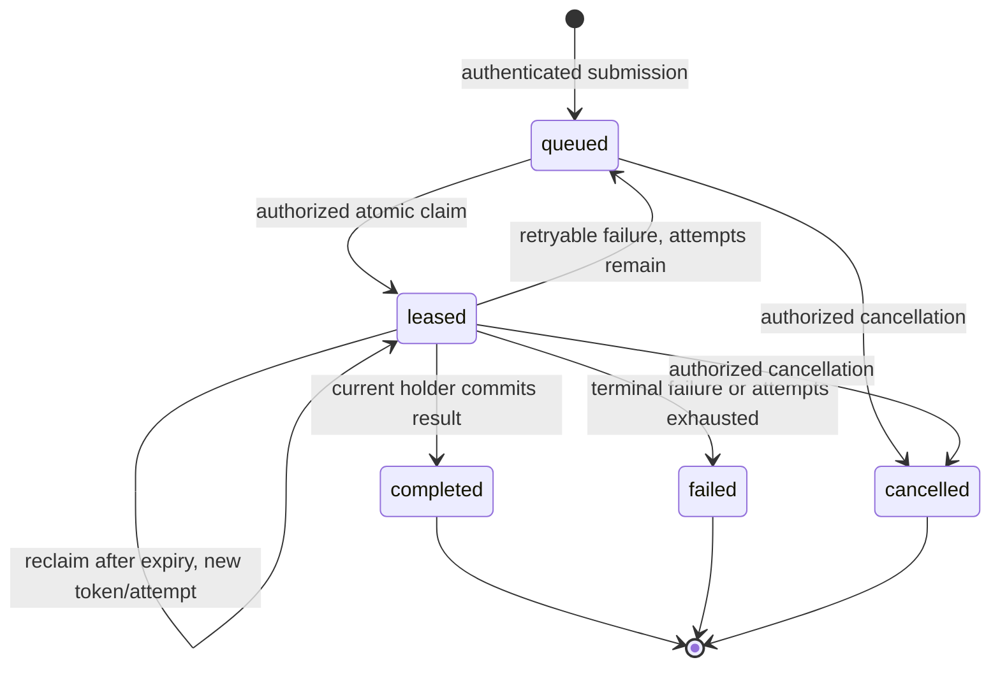

# Agent Task Lifecycle

This page explains the authenticated agent identity and durable work-lease slice.
It is a POC coordination model: the AHP host stores identity and work state, but
never runs a model, agent process, or filesystem executor. Workers run
independently and execute work in their own environment.

## End-to-end sequence

```mermaid
sequenceDiagram
    autonumber
    participant A as Planner / Client A
    participant H as AHP Host
    participant DB as PostgreSQL
    participant B as Agent B / Worker

    A->>H: Submit work (session, requestKey, kind, target B)
    H->>H: Authenticate, authorize, validate + deduplicate
    H->>DB: INSERT queued work (idempotent)
    DB-->>H: Durable workId
    H-->>A: Work accepted (workId)

    B->>H: Authenticate, register/reclaim agent identity
    H->>H: Bind live presence lease to actual connection
    H-->>B: agentId + presence expiry
    Note over H,B: v1 has no work-available push; the worker claims explicitly

    B->>H: Claim eligible work in authorized session
    H->>H: Verify principal, session, kind and live presence
    H->>DB: Atomic claim/reclaim (FOR UPDATE SKIP LOCKED)
    DB-->>H: Work + new fenced leaseToken + expiry
    H-->>B: Claimed work and lease

    B->>B: Execute within its own isolated environment
    B->>H: Renew work lease (workId, token)
    H->>DB: Conditional update: current holder + unexpired token
    DB-->>H: New expiry (or no match)
    H-->>B: Lease renewed (or rejected)

    B->>H: Complete (workId, token, bounded result)
    H->>H: Verify current presence, authorization and result shape
    H->>DB: Atomic fenced completion update
    alt Lease still valid and current
        DB-->>H: Completed row committed
        H-->>B: Completion accepted
        H-->>A: Result available via x-ahp/work/get
    else Expired, revoked or superseded lease
        DB-->>H: No matching current lease
        H-->>B: Stale/unauthorized completion rejected
        H-->>A: Result remains unchanged
    end
```

## What each step means

1. **Submission:** A client asks the host to persist work. It does not send
   instructions directly into another model's context or start a server-side
   agent. The host authenticates the connection, confirms the live session
   belongs to that principal, bounds the payload, and inserts one row keyed by
   `(session_uri, request_key)`.
2. **Registration:** An independently running agent authenticates. Durable
   identity and live presence are separate: PostgreSQL keeps the registration,
   while the host keeps the current connection, generation, and expiry in memory.
3. **Claim:** The database atomically grants one execution lease. A push
   notification never counts as a claim. A claim verifies the principal, session
   owner, live presence, enabled registration, work kind, and optional target.
4. **Execution:** The worker executes locally or in its own sandbox. No
   server-side Pi/model inference is assumed. A lease expiration does not stop a
   process by magic.
5. **Evaluation and commit:** Completion commits only if the caller, token,
   status, agent, session owner, and deadline still match. For code edits,
   artifacts must be isolated and independently evaluated before promotion.
6. **Recovery:** On disconnect or host restart, presence is lost but work remains.
   Another eligible agent may reclaim only once lease policy permits it, with a
   new token. There is no exactly-once side-effect guarantee.

## Identity, presence, and leases

| Concept | Source of truth | Lifetime | Proves work authority? |
| ------- | --------------- | -------- | ---------------------- |
| Principal | WebSocket upgrade authentication | Connection | Only as the session owner / caller |
| Agent registration | PostgreSQL `agent_registrations` | Durable | No; an agent can be offline |
| Presence binding | In-memory `AgentDirectory` | 90 s default TTL, renewed | Required for worker mutations |
| Work row | PostgreSQL `work_items` | Durable | No; a queued row is not assigned |
| Work lease | `work_items` token + deadline | 60 s default TTL | Yes, while current and unexpired |

An AHP `initialize.clientId` is never an identity. Request JSON cannot supply an
agent ID, principal, connection ID, or presence generation; the wire adapter
derives those from the live, authenticated connection.

## Work state machine



Claiming an expired lease is a retry, not a second copy of the work. The same
work ID remains, `attempt_count` increases, and the token rotates. A stale token
cannot renew, complete, or fail the newer attempt.

## Database model

The canonical relationship diagram and column rules are in
[`database/M2_AGENT_WORK_DATABASE_SCHEMA.md`](../../database/M2_AGENT_WORK_DATABASE_SCHEMA.md).
The executable DDL is in
[`database/migrations/0001_session_tool_baseline.sql`](../../database/migrations/0001_session_tool_baseline.sql)
and
[`database/migrations/0002_agent_work.sql`](../../database/migrations/0002_agent_work.sql).

Only `agent_registrations` and `work_items` are new for this slice. Presence,
sockets, subscriptions, active client tools, and replay state intentionally have
no SQL tables. Session disposal is rejected while any work row references the
session.

## Failure cases

- **No authenticator / no principal:** agent and work methods fail closed; no
  registration, presence, or work mutation occurs.
- **Duplicate registration:** the same principal and `agentKey` resolve one
  stable row. A second live connection cannot take over an unexpired binding.
- **Stale presence generation:** renewal and worker mutations fail; durable work
  and its lease remain.
- **Duplicate submission:** the same immutable payload returns the original work
  ID; a changed kind, input, or target is a conflict.
- **Concurrent claim:** `FOR UPDATE ... SKIP LOCKED` grants at most one current
  lease. The loser gets no work or a later eligible row.
- **Expired lease:** renewal and completion are rejected as stale; a later claim
  rotates the token and increments the attempt.
- **Retry exhausted:** reconciliation marks the row `failed`; it cannot be
  reclaimed.
- **Worker disconnect:** the lease is not deleted. It remains until expiry, then
  becomes reclaimable if attempts remain.
- **Host restart:** registrations and work rows survive if PostgreSQL survives;
  presence, sockets, subscriptions, and client tool advertisements do not.
- **Session disposal:** rejected with a conflict while dependent work exists.

## Security and safety boundaries

- Static bearer tokens are a POC authentication adapter, not a production
  identity system. Tokens are supplied through environment configuration and are
  never logged or echoed. Use `wss` behind a trusted TLS terminator; the plain
  `ws` examples bind loopback only.
- The POC authorization rule is same-principal ownership of the session. There is
  no cross-principal grant model yet.
- Lease fencing prevents an old worker from committing a result; it does not
  provide OS isolation. Concurrent code-editing attempts must run in separate
  workspaces, and a trusted evaluator must decide promotion.
- The host does not execute stored task input. Work payloads are data for a
  client worker, not server instructions.
- Large artifacts should be referenced, not embedded in JSONB. Results are
  bounded and may be exposed only to an authorized principal.

## Current status and evidence

**Implemented in code:** authentication boundary, registration/presence,
versioned `x-ahp/agents/*` and `x-ahp/work/*` methods, bounded work service,
PostgreSQL adapters, migrations, and unit/protocol tests.

**Verification status:** `pnpm validate` is the repository gate. The PostgreSQL
schema and race/fencing behavior are **not runtime-verified** in this workspace
because the user instructed that the migration scripts must not be applied yet.
The scripts are written and reviewed, but no database was migrated or queried.
Treat the SQL acceptance gates as **BLOCKED**, not passed.

**Not implemented:** production identity/OIDC, cross-principal sharing, durable
presence, event replay, server-side execution, workflow DAGs, and automatic
wind-down of a worker that lost its lease.

## Related documentation

- [`docs/plans/ProvidersPlan.md`](../plans/ProvidersPlan.md) — M2 identity /
  presence and M4 coordination boundaries.
- [`database/M2_AGENT_WORK_DATABASE_SCHEMA.md`](../../database/M2_AGENT_WORK_DATABASE_SCHEMA.md)
  — ERD, DDL intent, state machine, and invariants.
- [`src/work/README.md`](../../src/work/README.md) — application service.
- [`src/agents/README.md`](../../src/agents/README.md) — authentication and
  presence.
- [`src/persistence/README.md`](../../src/persistence/README.md) — SQL adapters.
- [`src/websocket/README.md`](../../src/websocket/README.md) — versioned wire
  extension.
