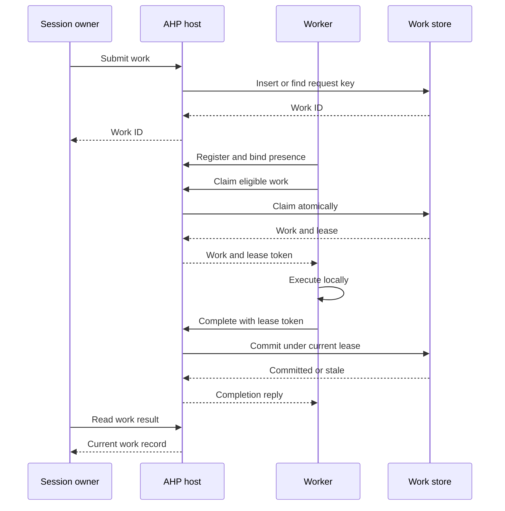
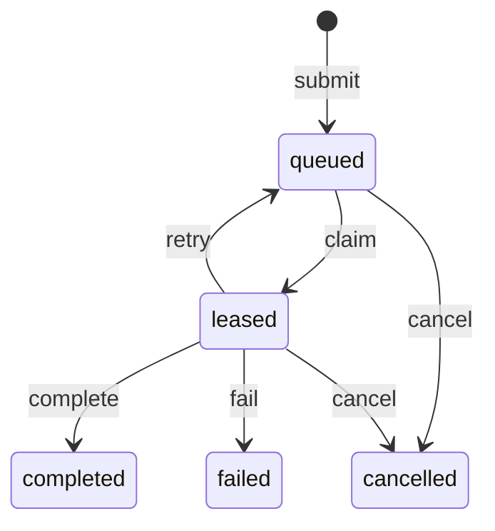

# Agent Task Lifecycle

This page explains the authenticated agent identity and durable work-lease slice.
It is a POC coordination model: the AHP host stores identity and work state, but
never runs a model, agent process, or filesystem executor. Workers run
independently and execute work in their own environment.

## Work service sequence

The diagram describes the in-process work service. Through P2 the WebSocket
binding exposes agent registration, presence renewal, unregistration and work
reads. Clients receive `MethodNotFound` for work mutations.

Workers claim explicitly. The host publishes no work-available push. A worker
can renew its lease during execution. The host checks the live worker binding
and lets the repository enforce the current token and deadline on each write.

## What each step means

1. **Submission:** A client asks the host to persist work. It does not send
   instructions directly into another model's context or start a server-side
   agent. The host authenticates the connection, confirms the live session
   belongs to that principal, bounds the payload, and inserts one row keyed by
   `(session_uri, request_key)`.
2. **Registration:** An independently running agent authenticates. Durable
   identity and live presence are separate: PostgreSQL keeps the registration,
   while the host keeps the current connection, generation, and expiry in memory.
3. **Claim:** The database atomically grants one execution lease. A push
   notification never counts as a claim. A claim verifies the principal, session
   owner, live presence, enabled registration, work kind, and optional target.
4. **Execution:** The worker executes locally or in its own sandbox. No
   server-side Pi/model inference is assumed. A lease expiration does not stop a
   process by magic.
5. **Evaluation and commit:** Completion commits only if the caller, token,
   status, agent, session owner, and deadline still match. For code edits,
   artifacts must be isolated and independently evaluated before promotion.
6. **Recovery:** On disconnect or host restart, presence is lost but work remains.
   Another eligible agent may reclaim only once lease policy permits it, with a
   new token. There is no exactly-once side-effect guarantee.

## Identity, presence, and leases

| Concept | Source of truth | Lifetime | Proves work authority? |
| ------- | --------------- | -------- | ---------------------- |
| Principal | WebSocket upgrade authentication | Connection | Only as the session owner / caller |
| Agent registration | PostgreSQL `agent_registrations` | Durable | No; an agent can be offline |
| Presence binding | In-memory `AgentDirectory` | 90 s default TTL, renewed | Required for worker mutations |
| Work row | PostgreSQL `work_items` | Durable | No; a queued row is not assigned |
| Work lease | `work_items` token + deadline | 60 s default TTL | Yes, while current and unexpired |

An AHP `initialize.clientId` labels the connection. A work request can select
a target agent, but the wire adapter derives the caller's principal, executing
agent, connection ID, and presence generation from the live binding.

## Work state machine

Renew and reclaim both keep the `leased` status. Renewal extends the deadline
for the current holder. Reclaim requires an expired lease and an available
attempt. It keeps the work ID, increments `attempt_count`, and rotates the
token. The old token cannot renew, complete, or fail the new attempt. A
retryable failure with attempts left returns to `queued`. Terminal failures and
expired leases with an exhausted attempt budget end in `failed`.

## Database model

The canonical relationship diagram and column rules are in
[`database/M2_AGENT_WORK_DATABASE_SCHEMA.md`](../../database/M2_AGENT_WORK_DATABASE_SCHEMA.md).
The executable DDL is in
[`database/migrations/0001_session_tool_baseline.sql`](../../database/migrations/0001_session_tool_baseline.sql)
and
[`database/migrations/0002_agent_work.sql`](../../database/migrations/0002_agent_work.sql).

Only `agent_registrations` and `work_items` are new for this slice. Presence,
sockets, subscriptions, active client tools, and replay state intentionally have
no SQL tables. Session disposal is rejected while any work row references the
session; a submission that settles after its live session was disposed in a
concurrent request triggers a best-effort cancel of the just-recorded row and a
conflict reply. A failed cancel leaves the row behind, which keeps blocking
disposal of the URI until it is resolved operationally.

Application services consume the database-neutral `PersistenceProvider`
contract. The adapter registry currently defaults to PostgreSQL and owns the
adapter selection and cleanup. The provider contract and in-memory conformance
tests demonstrate substitution; they do not prove real database lock, rollback,
or database-clock behavior.

Run the [advanced review example](../guides/advanced.md) for the owner and
worker flow over loopback. Use [PostgreSQL conformance](../guides/postgresql.md)
to verify a local adapter against the real database.

## Failure cases

- **No authenticator / no principal:** agent and work methods fail closed; no
  registration, presence, or work mutation occurs.
- **Duplicate registration:** the same principal and `agentKey` resolve one
  stable row. A second live connection cannot take over an unexpired binding.
- **Stale presence generation:** renewal and worker mutations fail; durable work
  and its lease remain.
- **Duplicate submission:** the same immutable payload returns the original work
  ID; a changed kind, input, or target is a conflict.
- **Concurrent claim:** `FOR UPDATE ... SKIP LOCKED` grants at most one current
  lease. The loser gets no work or a later eligible row.
- **Expired lease:** renewal and completion are rejected as stale; a later claim
  rotates the token and increments the attempt.
- **Retry exhausted:** reconciliation marks the row `failed`; it cannot be
  reclaimed.
- **Worker disconnect:** the lease is not deleted. It remains until expiry, then
  becomes reclaimable if attempts remain.
- **Host restart:** registrations and work rows survive if PostgreSQL survives;
  presence, sockets, subscriptions, and client tool advertisements do not.
- **Session disposal:** rejected with a conflict while dependent work exists.

## Security and safety boundaries

- Static bearer tokens are a POC authentication adapter, not a production
  identity system. Tokens are supplied through environment configuration and are
  never logged or echoed. Use `wss` behind a trusted TLS terminator; the plain
  `ws` examples bind loopback only.
- Durable work is restricted to the session owner's principal, including any
  targeted worker. The separate [tool authorization model](../../src/authorization/README.md)
  supports scoped participant grants for private tool calls and resource access.
- Lease fencing prevents an old worker from committing a result; it does not
  provide OS isolation. Concurrent code-editing attempts must run in separate
  workspaces, and a trusted evaluator must decide promotion.
- The host does not execute stored task input. Work payloads are data for a
  client worker, not server instructions.
- Large artifacts should be referenced, not embedded in JSONB. Results are
  bounded and may be exposed only to an authorized principal.

## Current status and evidence

**Implemented in code:** authentication boundary, registration/presence,
versioned `x-ahp/agents/*` and `x-ahp/work/get` methods, bounded work service,
database-neutral persistence contracts/facades, the PostgreSQL adapter,
migrations, and unit/protocol tests.

**Verification:** `pnpm validate` exercises service and wire behavior with local
fixtures and checks PostgreSQL query shape offline. The [PostgreSQL guide](../guides/postgresql.md)
describes the separate database run required to test SQL behavior.

**Not implemented:** production identity/OIDC, cross-principal durable work, durable
presence, event replay, server-side execution, workflow DAGs, and automatic
wind-down of a worker that lost its lease. Work-kind eligibility is host-global
in V1 — one configurable allow-list shared by every agent; per-agent kind grants
from the task plan are deferred (a contract change, not a configuration task).
There is also no retention path: `work_items` rows and the durable `sessions` row
they first landed are never deleted (live disposal only removes in-memory
state), so a retain/cancel-and-archive policy is required before production use.

## Related documentation

- [`docs/plans/ProvidersPlan.md`](../plans/ProvidersPlan.md) — M2 identity /
  presence and M4 coordination boundaries.
- [Durable relationships and schema invariants](../../database/M2_AGENT_WORK_DATABASE_SCHEMA.md)
- [`src/work/README.md`](../../src/work/README.md) — application service.
- [`src/agents/README.md`](../../src/agents/README.md) — authentication and
  presence.
- [`src/persistence/README.md`](../../src/persistence/README.md) — SQL adapters.
- [`src/websocket/README.md`](../../src/websocket/README.md) — versioned wire
  extension.
