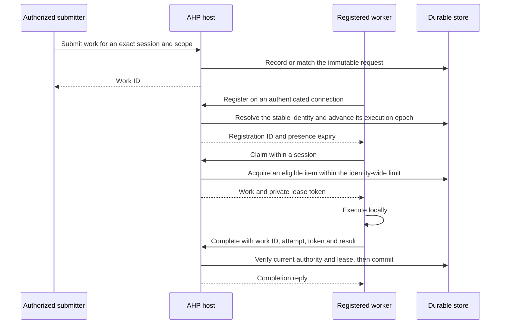
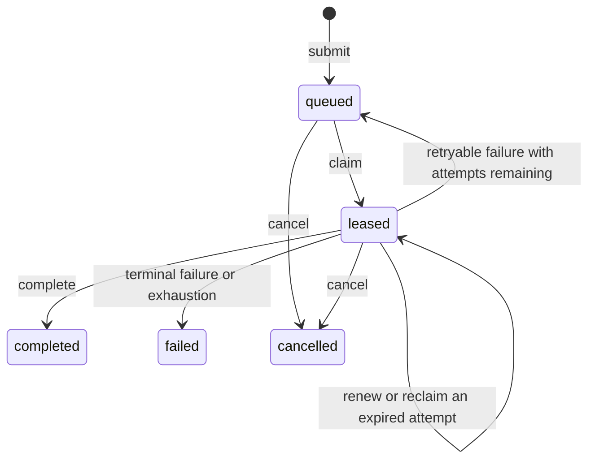

# Agent task lifecycle

A protected AHP host records work and leases. Workers run independently and
execute the work in their own environment. A session owner, a work submitter
and a registered executor may be three different principals.

## From submission to settlement

1. **Submit.** The host resolves the exact session incarnation, validates the
   work kind and selectors, and checks the caller's submit grants. An authorized
   retry with the same request key and complete intent receives the original ID.
   A different intent with the same key conflicts.
2. **Register.** The host maps the authenticated agent actor to its durable
   registration key. It reserves the identity and connection, commits an epoch
   increment, and publishes live presence if the connection is still current.
   Repeating registration on that connection preserves its epoch. Disabling an
   agent withdraws local presence immediately. Re-enabling requires a fresh bind.
3. **Claim.** The worker supplies a session locator. The host checks its current
   grants and allowed kinds. The repository claims a prepared candidate under
   the active-claim limit. Higher priorities come first among eligible unlocked
   rows in the evaluated scan. The private reply reports `claimed`, `empty`,
   `capacity` or `deferred`.
4. **Execute.** The worker can renew its unexpired lease and use a work-tagged
   tool or resource operation when its independent base permissions also allow
   that operation. Lease credentials stay private to the executing connection.
5. **Settle.** Complete or fail supplies the work ID, attempt and token. The
   host checks the current registered identity, epoch, scope and work policy.
   The repository verifies the exact lease and its deadline before committing.
   A lost reply can be reconciled through an authorized work read.

## What survives a disconnect

| Value | Owner | Lifetime |
| --- | --- | --- |
| Verified principal and canonical actor | Host security composition | Authenticated connection |
| Registered identity and execution epoch | Durable registration repository | Across reconnects and host restarts |
| Presence, connection ID and local generation | Agent directory | Until disconnect, withdrawal or presence expiry, 90 seconds by default |
| Work, attempt count and latest failure | Exact session's durable work store | Through retirement until eligible purge |
| Lease | Work row, bound to a registration and execution epoch | Until settlement, an authorized disposition or deadline, 60 seconds by default |

The default capacity is three active claims across all sessions per registered
identity. A trusted override may replace this limit or restrict kinds. Lowering
capacity preserves existing leases and permits valid renewals. Reconnecting
allocates a new execution epoch. The old leases still occupy capacity until
release or expiry, while their tokens can no longer authorize the new connection.

## Work state changes

A replacement claim keeps the work ID, increments the attempt and rotates the
token. Bounded maintenance can mark an exhausted, expired lease failed. A
worker that has lost authority may still be running outside the host. The
application owns isolation, idempotency of external effects and artifact review.

## Storage and verification

The PostgreSQL adapter stores registrations and work under a durable logical
host ownership fence. Session and canonical-resource lifecycle writes advance
graph revisions. Retirement checks nonterminal work dependencies and eligible
terminal history can later be purged in bounded batches.
[Persistence](../../src/persistence/README.md) · [Migrations](../../database/migrations)

Run `pnpm exec vite-node examples/work-capacity.ts` for two workers sharing two
sessions, reconnect, expiry and a successful replacement settlement. The
advanced review example demonstrates distinct submitter, owner and executor
principals. The dedicated PostgreSQL runner exercises two-pool epoch and
capacity races against the real database.
[Advanced review](../guides/advanced.md) · [PostgreSQL conformance](../guides/postgresql.md)

[Agent directory](../../src/agents/README.md) · [Work service](../../src/work/README.md) · [WebSocket methods](../../src/websocket/README.md)
