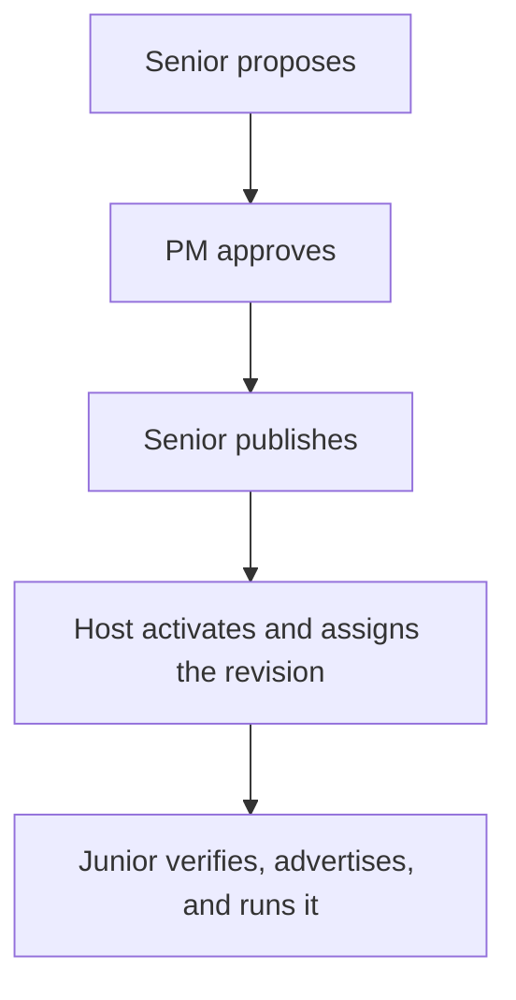

# Run a protected review application

```sh
pnpm exec vite-node examples/advanced/index.ts
```

The default run selects policies through an included namespace. To see the
same workflow with direct admission, run:

```sh
pnpm exec vite-node examples/advanced/index.ts -- --direct
```

The script binds to loopback, creates a typed review session, connects real SDK
clients over WebSocket, and stops the host when the assertions finish. The demo
uses fixed local identities, an inert artifact, and a process-local repository
adapter. The [PostgreSQL chapter](postgresql.md) covers an optional storage run.

## Who can do what

| Actor | What the demo authorizes |
| --- | --- |
| Senior owner | Owns the session, reads the submitted review, calls the client and host tools, and proposes, publishes, and activates an approved tool. |
| Junior agent | Registers under its own principal. Holds a scoped work execution grant and a separate client tool assignment. Runs the inspection and loads the assigned artifact. |
| Project manager | Reads the session, submits a review for the junior worker and approves a tool proposal. Work detail reads require a separate grant. |
| Observer | Can read the protected session view. Private tool metadata stays out of that snapshot. |

`clientId` labels a connection. The demo authenticator resolves the principal
from its loopback handshake, then the host classifies the actor and installs
scoped bindings and exact assignments. Namespace selection supplies a policy
ceiling. The registered binding and assignment supply the actual authority.

## Follow one review

1. **Target another principal's worker.** The host maps the junior's canonical
   actor `review-agent` to registration key `review-worker-v1` in the `demo`
   domain. The junior registers and renews its presence. The project manager
   submits through the in-process work service, targeting that registration in
   the senior's session. The senior reads the job and its recorded submitter.
   The canonical registry confirms the junior's scoped execution grant.
   The worker's network detail read returns `work: null`.
   The junior claims and completes the job over its registered connection.
   The senior verifies completion and the host revokes the junior's work grant.
   [Work lifecycle](../architecture/agent-task-lifecycle.md)
2. **Subscribe to the protected session.** The observer gets a `ready` snapshot
   without the private tool manifest. The application separately grants SDK
   initialization access to the host-wide sequence cursor.
3. **Call the client executor.** The junior agent calls its own tool. The senior
   calls the same executor over a distinct connection. Each call stops at a
   challenge before execution. The fixture proof resumes the original call. It
   is local example data, not a real verification service.
4. **Try a denial.** With provider consent disabled, the senior's otherwise
   eligible call is denied. The PM's separate attempt has no invoke assignment.
   Both leave the handler count, canonical snapshot, and observer snapshot unchanged.
5. **Project a host result.** The server echo returns `Review ready`. A separate
   resource operation validates that result and updates the title through the
   native reducer. The client receives the tool result privately.
6. **Publish and load a tool.** The senior proposes, the PM approves, and the
   senior publishes. The live manifest changes only after trusted activation.
   The junior then receives the exact assignment, verifies the artifact, and
   advertises the resulting local handler before executing it.



Each step has its own authority. An approved definition becomes usable only
after the host activates it and grants the exact assignment.

The public host integration test has the registered junior claim through the
WebSocket API. It exercises tagged tool dispatch and a direct resource-data
replacement against the returned private lease. Revoking the work grant
while the provider write waits preserves both its previous data and revision.
[Cross-principal integration](../../src/tests/websocket/crossPrincipalWork.test.ts)

## Read the example code

Run `pnpm exec vite-node examples/work-events.ts` to follow the same review across
two protected clients and two provider-created chats. The senior receives
authorized system notifications through an explicit presentation handler.
The observer can discover the chat and receives an empty work view. An
excluded child stays empty for the senior as well. The sample drops the final
change hint, waits for the five-second reconciliation interval, and reconnects
the senior with a fresh transport to recover the cancelled item.

| File | Why to read it |
| --- | --- |
| [index.ts](../../examples/advanced/index.ts) | Runs both forms of client invocation, the denial, the host action, and the proposal-to-artifact flow. |
| [host.ts](../../examples/advanced/host.ts) | Composes the registry, provider rules, SDK host, and public extension ports. |
| [work.ts](../../examples/advanced/work.ts) | Submits a targeted review and checks the worker's presence, separate execution and read permissions, and revocation. |
| [workEvents.ts](../../examples/advanced/workEvents.ts) | Connects the native SDK and work projection to one reader, registers the guarded chat presentation, and checks recovery and recipient isolation. |
| [work-capacity.ts](../../examples/work-capacity.ts) | Exercises default and identity-specific limits across two sessions, then reconnects, waits for a lease to expire, reclaims the work and completes the new attempt. Run with `pnpm exec vite-node examples/work-capacity.ts`. |
| [persistence.ts](../../examples/advanced/persistence.ts) | Supplies in-memory registrations and exact-instance durable storage, and rejects URI-only session and work mutations. |

The artifact loader selects a known local handler for the verified fixture bytes.
Your application owns publisher trust, the artifact format, and runtime isolation.
The example provider keeps registrations, exact session instances and work in memory.
The senior reads the submitted job using the protected work service. For network and
storage integration details, see the [wire contract](../technical/wire-contract.md)
and the [persistence module](../../src/persistence/README.md).

## Adapt the composition

### Migrate a connection or work-policy provider for scheduling

If your connection setup or work narrowing callback already returns
`isCurrent`, keep that check and add a revocation source. The same membership
change that makes `isCurrent()` false must abort the source immediately. The
host checks the captured source after waiting for durable locks. The following
fields can be included in an initial-authority receipt or an allowing work
restriction. Keep the receipt's existing scopes or effect, deadline and cleanup.

```ts
const revoked = new AbortController();
const unsubscribe = membership.onRevoked(() => revoked.abort());
const authority = {
  signal: revoked.signal,
  isCurrent: () => membership.isCurrent() && !revoked.signal.aborted,
  release() {
    unsubscribe();
    revoked.abort();
  },
};
```

An application that already invalidates the host's canonical work registry can
return `invalidation: "registry"` and call
`registry.invalidateExternal(revision)` synchronously on every withdrawal.
Supply one of these contracts independently on the hosted initial-authority
receipt and on each optional claim/renew narrowing receipt. The example's
default initial authority lasts for the connection and uses its lifetime signal.
Existing callback-only initial authority continues to support native operations.

1. Supply your provider and typed session catalogue. Keep application config,
   provider config, and the pinned revision of each tool explicit. [Sessions](../../src/sessions/README.md)
2. Use a trusted authenticator, resolve the real user or agent, and scope each
   grant to the intended resource. Enable cursor consent and protected views for
   the SDK peers that need native subscriptions. [Authorization](../../src/authorization/README.md)
3. Supply exact caller and executor assignments for each tool. Use a host
   registration for trusted local code and an SDK advertisement for a client
   handler. The client API also exposes status, cancellation, and approved
   artifact loading. [SDK tool client](../../src/toolClient/README.md)
4. Configure the work repositories for durable execution epochs and exact
   session storage. Grant each work operation to its intended actors and set a
   trusted capacity override where needed. [Work service](../../src/work/README.md)

[Five-minute example](quickstart.md) · [Documentation index](../README.md)
