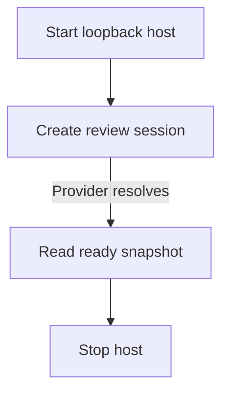

# Create your first session

From the repository root, use Node.js 24 and pnpm 10.34.6:

```sh
pnpm install
pnpm exec vite-node examples/quickstart.ts
```

The port is chosen for this run. The output ends like this:

```text
Host listening on 127.0.0.1:<port>
Session ahp-session:/first-review is ready
```



The example waits for the provider and verifies the lifecycle before it prints
success. It stops the host even when setup fails.

1. `createAHPServer` owns the listener, session factory, and shutdown. `port: 0`
   lets the OS choose a free port.
2. `createBaselineSessionApplication` supplies `code-review@1` and its config
   contract. The mock provider implements the session lifecycle locally.
3. `createApplicationSession` makes a trusted in-process call.
   `getSessionSnapshot` returns a detached copy of the session state. The
   example checks `snapshot.state.lifecycle` for `ready`.

The script lives in [examples/quickstart.ts](../../examples/quickstart.ts).
Remote SDK connections use the separate security and read gates shown in the
[advanced review application](advanced.md).

[Documentation index](../README.md)
