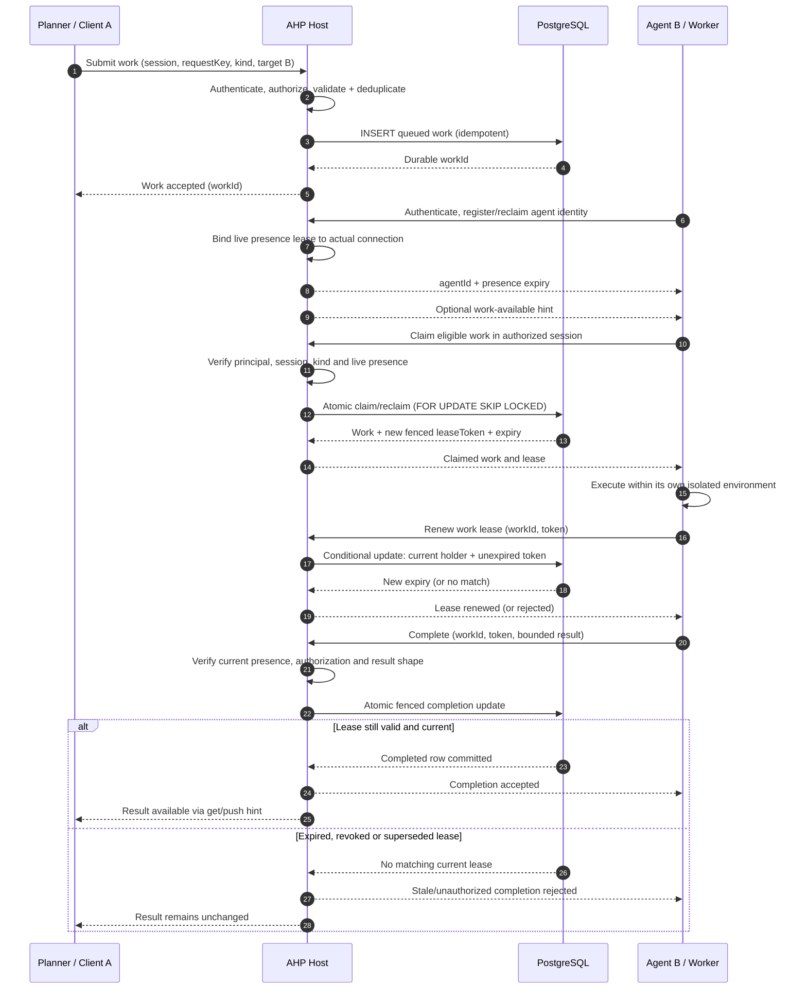

# TASK PLAN — Agent Hosting Protocol M2 Identity / Presence + Durable Agent Work Leases

> **Status:** PLAN READY — no code or SQL has been executed. This document is an implementation handoff to the user's **two local DeepSeek agent terminals**; it is not evidence of completion.
>
> **Repository:** [`spore310/AHP`](https://github.com/spore310/AHP), planned against `develop` at **`2f9900a65386f8ebc03feebc694c2c61c2b3c332`** (verified 2026-10-19). Refresh local HEAD and worktree before implementation; stop/rebase the plan if contracts materially changed.
>
> **Intended repository location:** `docs/plans/M2_AGENT_IDENTITY_WORK_LEASING_TASKPLAN.md`.
>
> **Companion schema:** `database/M2_AGENT_WORK_DATABASE_SCHEMA.md` (copy the other supplied Markdown file there before implementation).
>
> **Execution model:** Two DeepSeek-powered **local terminals**, intentionally constrained by bounded write ownership. Its reported 500k context window is available for research and cross-checks, but context size is not authorization to rewrite the repository.
>
> **Authority:** Code = current behavior. Accepted user goals = target state. Published DB scripts, when created, own SQL DDL; ORM mappings cannot invent a separate schema. Never edit external repositories, deploy, push, or create cloud resources without user permission.

---

## 0. Exact goal and scope

### Deliverable

Build a minimal, extensible identity-and-work coordination baseline where independently running AHP clients can:

1. **Authenticate** using a trusted host-configured mechanism (not self-reported AHP `clientId`).
2. Register or reclaim a stable **agent registration** under their authenticated principal.
3. Establish, renew, and end a **live in-memory agent presence lease**, bound to the actual WebSocket connection and a connection generation.
4. Submit idempotent, bounded work against an **authorized AHP session**; optionally target a registered agent.
5. Claim eligible work atomically, obtain a **durable SQL execution lease**, renew it, complete/fail it, and retrieve the status/result.
6. Survive process restart **for durable work/agent identity and supported session state**; not for socket presence, active client tools, or streaming event replay.
7. Prove with deterministic integration tests that authorization, claim races, stale tokens, retry limits, cancellations, disconnects and reconnection behave correctly.
8. Publish a comprehensible **agent-task lifecycle document** containing the exact Mermaid sequence diagram below.

### Milestone classification

`docs/plans/ProvidersPlan.md` defines **Milestone 2 (M2)** as **remote-client identity / presence design**, including lease renewal and identity reclaim. **Milestone 4 (M4)** holds work delivery/coordination. The user requests a bounded **M4 work-assignment and work-lease slice alongside M2**, suitable for a POC. Don't mark all of M4 done, or rewrite the existing milestone's accepted semantics.

### Must preserve

- Single-node, capability-oriented modular monolith. No broker, Kubernetes, microservice, queue service or second host deployment.
- `@microsoft/agent-host-protocol@1.0.0` remains pinned unless an independently approved upgrade is needed.
- Agent/model/Pi runtime runs on **clients**, not in this AHP server. This task adds **identity, work assignment and state**, not autonomous model inference or server-owned tool execution.
- Existing `SessionProvider` remains the code-side lifecycle seam; never treat a database `agent_registrations` row as a `SessionProvider` or invent provider rows to pretend clients are server-hosted agents.
- Existing `SessionRegistry` stays the **synchronous live-state owner**. A separate async durable repository is required. Never conceal PostgreSQL I/O behind the synchronous registry's `add/get/delete` methods.
- Existing session-type/tool contracts and client-to-client `x-ahp/tools/*` bridge continue to work without adopting work assignment. They are not replaced with a SQL queue.
- Work item assignments and results are scoped to an authorized session; client tool advertisements are not proof of identity or permissions.
- **Presence** is in-memory now; Redis is deferred. Do not create `agent_presence`, `agent_leases`, `session_active_clients`, socket, subscription or runtime tool-state SQL tables.
- Chat and terminal channels, full workflow orchestration, event replay, Pi extension, and sandbox runner are out of scope.

### Current verified evidence

| Concern | Actual source on `develop` | Consequence |
|---|---|---|
| Session composition | `src/index.ts`; `src/websocket/helpers/host/helpers.ts` | Default host uses mock provider and `createBaselineSessionApplication()`; no SQL/auth injection yet |
| AHP peer | `src/websocket/helpers/ahp/types.ts` | `clientId` is self-declared; peer owns `context.connectionId`, subscriptions and phase |
| Session factory | `src/sessions/helpers/factory/helpers.ts` | Synchronous Map-based registry and reducer, no durable state |
| Agent backend lifecycle | `src/sessions/types.ts` | `SessionBackend` exposes only `dispose()` |
| Client tool bridge | `src/websocket/helpers/ahp/toolInvocation.ts`; `src/toolClient/` | Validated short-lived client tool calls, not durable work assignment |
| DB proposal | `database/session-tables.md` | Three-table proposal only, no SQL/migrations |
| Target DB shape | `docs/plans/tools and session types/FUTURE_PERSISTENCE.md` | Five-table future design, not implemented |
| M2/M4 definition | `docs/plans/ProvidersPlan.md` | M2 presence, M4 addressed coordination |
| Repository rules | `.agents/AGENTS.md`, `docs/CodingRules.md` | Public `index.ts`, `types.ts` contracts, `helpers.ts` implementation; tests only `src/tests/` |

**Before writing:** rerun repository HEAD/worktree inspection. Do not infer that `database/` has applied migrations because a Markdown schema exists. Review latest code at the actual local checkout, including untracked files. Record any deviation from the pinned SHA in the task ledger.

---

## 1. Architecture contract to freeze before delegation

### Logical ownership

```text
              Independently running AHP client processes
                                |
                   Authenticated AHP connection
                                |
                  +-------------v-------------+
                  |   WebSocket / AHP binding   |
                  | Versioned x-ahp/* requests |
                  +-------------+-------------+
                                |
       +------------------------+-------------------------+
       |                        |                         |
+------v-------+      +---------v---------+      +--------v---------+
| Agent        |      | Session factory   |      | Work application |
| registration |      | and live registry |      | service          |
| + in-memory  |      | unchanged owner   |      | claim/renew/     |
| presence     |      | of AHP state      |      | complete/fail    |
+------+-------+      +---------+---------+      +--------+---------+
       |                        |                         |
       |                        |              +----------v-----------+
       +------------------------+------------->| Async persistence     |
                                               | ports                 |
                                               +----------+-----------+
                                                          |
                                                 PostgreSQL adapters
                                                          |
                        host_state / sessions / session_types / tools
                        session_type_tools / agent_registrations / work_items
```

### Agent identity ≠ AHP `clientId` ≠ WebSocket connection

**Principal**: Verified subject provided by an authenticator or trusted proxy. Must come from a server-owned authentication interface, not `initialize.clientId`, a session payload, or tool metadata.

**Agent registration**: Durable row `{ id, principalSubject, agentKey, enabled }`, uniquely keyed by `(principalSubject, agentKey)`; one principal may register several agents.

**Live presence**: In-memory mapping `{ agentId, principalSubject, connectionId, generation, expiresAt }`, established only after verified authentication and registration. A close callback from an old generation cannot take a newer live registration offline. Only one effective live binding per agent identity at a time; duplicate-current registration must be denied or handled by an explicit, tested takeover contract (choose **deny while current lease valid** for V1).

**Work target**: Optional `target_agent_id` in a queued row. Only determines intended recipient.

**Work lease holder**: `lease_agent_id` plus token and deadline; only one current holder per row. Connection presence and task lease are different; a disconnect does **not** erase the work row or its unexpired lease.

### Contract and security invariants

- All new wire methods are **namespaced** and **not standard AHP commands**. Do not redefine `createSession`, `dispatchAction`, `subscribe`, or native SDK payloads.
- Prefer **JSON-RPC requests** for registration and work mutations because clients need explicit success/failure responses; optional work-available push is only a hint.
- **Fail closed:** No authenticated principal -> no registration, presence lease, work submit, claim, renew, completion or privileged read. An unspecified auth adapter is not an anonymous admin adapter.
- AHP session membership or tool visibility does not confer work permissions. Authorize the principal + session + operation + agent registration + task kind.
- Pin names/versioned DTO schemas before implementation; all client-provided fields must be validated, JSON-compatible and bounded. Never let clients select a SQL lease agent by simply passing arbitrary `agentId`.
- Stored `work_items` data is not an instruction to execute on the server. The worker application interprets its own task payload subject to its sandbox/tool policy.
- Work execution is **at least once** under expiry/retry; SQL guarantees at most one *current authority to commit* a result, not exactly-once side effects. Isolation is required for coding agents that can mutate workspaces.
- Never store auth credentials, private prompts, runtime socket state or raw filesystem dumps in SQL. Use safe artifact references for large output.

---

## 2. Database implementation target

### Canonical seven-table baseline

The reference is `database/M2_AGENT_WORK_DATABASE_SCHEMA.md` supplied with this plan. **Exactly two newly scoped tables** are `agent_registrations` and `work_items`. The five prerequisite session/tool tables are `host_state`, `sessions`, `session_types`, `tools`, `session_type_tools`, still only proposed on the checked branch.

**Resolve first:** the older `database/session-tables.md` proposes `action_sequence`, `sessions` with duplicated fields and `session_active_clients`, which conflicts with the five-table future handoff. Converge on **one** authoritative schema and corresponding SQL migrations. Do not create parallel tables/ORM definitions under different names. Keep `sessions.owner_principal_subject` (verified creator/owner) as the sole extra baseline column for V1's same-principal scope; do not introduce a users/roles/grants table just for this task.

#### Migration policy

- The database dialect is still **proposed PostgreSQL**, not an already deployed product choice. Confirm environment/dev DB support as the first execution gate. If absent, finish architecture + SQL reference and label runtime DB acceptance **BLOCKED**, not “passed.” No accidental cloud provisioning.
- Suggested migration ownership: `database/migrations/0001_session_tool_baseline.sql` then `database/migrations/0002_agent_work.sql`. Names can adapt to an existing repository migration convention discovered at checkout; no parallel schema generation.
- Create forward migration, dev/test setup, schema verification and rollback **guidance**, not a destructive automated production rollback for persisted work. Avoid `DROP TABLE CASCADE` in runbooks.
- Ensure `work_items.session_uri` FK has a real SQL `sessions` parent. Do not “solve” this by pointing to a Map, removing the FK, or duplicating the entire session record into work JSON.
- SQL source of truth resides under `database/`; if an ORM is later selected it follows those scripts. Prefer a direct parameterized `pg` adapter or existing installed DB integration when one is available; justify/pin any new package.
- Use `clock_timestamp()`/`statement_timestamp()` for server-controlled deadlines; the repository's `now()` test clock is not authoritative for database lease expiration. Keep server and database clocks in tests clearly distinguished.

#### Data integrity rules

1. One registration per principal+agent key; re-registration yields existing ID for matching verified principal.
2. `request_key` is unique within a session; replay of the same normalized immutable submission reuses ID, while a payload mismatch conflicts.
3. Current lease exists iff status=`leased` and all three lease fields are present. Never let `queued/completed/failed/cancelled` retain an active claim.
4. Claiming is an atomic DB update under row lock; token rotated on every attempt. The only accepted completion is from current `lease_agent_id` **and** token **and** unexpired lease **and** authorized caller.
5. `attempt_count` increments on successful (re)claims; `max_attempts` stops retry. A bounded reconciliation operation terminalizes expired attempts that exhausted their budget.
6. Session disposal cannot silently cascade active jobs. Define the default as **reject disposal when dependent work rows remain**, until cancellation/archive retention is explicitly designed. FK `ON DELETE RESTRICT` enforces this.
7. Never promote a worker's changed files to a shared checkout solely because it returned `completed`. A trusted evaluator checks artifacts, and a separate authorized promotion mechanism decides release.
8. No SQL presence state. Online agent availability comes only from currently authenticated live connections.

### Atomic SQL acceptance

The companion schema includes reference DDL and three fenced statements: claim/reclaim via `FOR UPDATE OF w SKIP LOCKED`, renew, and complete. DeepSeek must run those statements in a real test database and verify concurrent behavior, not copy them untested. PostgreSQL specifically documents `SKIP LOCKED` as appropriate for competing queue-like consumers, not general-purpose consistent reads: <https://www.postgresql.org/docs/current/sql-select.html>.

---

## 3. Proposed module/API contracts (freeze then implement)

Use the repository's `types.ts`, `helpers.ts`, `index.ts` conventions. These shapes describe *architecture intent*. They are not existing exports and need not be copied character-for-character if a simpler type-safe contract satisfies the same invariants.

### 3.1 Authentication adapter — transport boundary

```ts
interface AuthenticatedPrincipal {
  readonly subject: string;
  // Other trusted claims are optional; never accept caller-provided role values.
}

interface ConnectionAuthenticator {
  authenticate(input: TrustedHandshakeContext): Promise<AuthenticatedPrincipal>;
}

interface AuthorizedAgentContext {
  readonly principal: AuthenticatedPrincipal;
  readonly agentId: string;       // bound after registration
  readonly connectionId: string;  // actual socket identity
  readonly generation: number;    // ephemeral presence epoch
}
```

`TrustedHandshakeContext` is **server-sourced** (for example validated bearer credential or trusted upstream gateway assertion). Do not treat `AHP initialize.clientId` as this context. Do not log raw credentials or store bearer tokens. Authentication must finish before enabling agent/work routes. Preserve compatibility for existing **loopback-only untyped/core AHP tests** while ensuring any unconfigured agent/work feature denies access. Decide the actual auth mechanism and test implementation without claiming full production identity infrastructure.

**Authorization adapter** must implement the policy to check: session ownership; registration principal; submitted target ownership; allowed work kind; claim eligibility; status reads; current-lease completion. V1's default POC policy is **same principal as session owner**. Later cross-principal sharing needs a separate reviewed grant model.

### 3.2 Agent registration/presence capability

```ts
interface AgentDirectory {
  register(principal: AuthenticatedPrincipal, key: string, displayName?: string): Promise<AgentRegistration>;
  bindPresence(agentId: string, principal: AuthenticatedPrincipal, connectionId: string): PresenceBinding;
  renewPresence(binding: PresenceBinding): PresenceBinding;
  releasePresence(binding: PresenceBinding): void;
  getOnline(agentId: string): PresenceBinding | undefined;
}

interface PresenceBinding {
  readonly agentId: string;
  readonly principalSubject: string;
  readonly connectionId: string;
  readonly generation: number;
  readonly expiresAt: number;
}
```

`AgentDirectory` may internally coordinate a persistent `AgentRegistrationRepository` plus an **in-memory** `PresenceRegistry`; don't put SQL in a WebSocket handler. Renewal must be tied to exactly the live binding and generation. Reclaim after expiry should preserve stable ID and invalidate stale connection callbacks; a current different connection cannot silently hijack the ID.

### 3.3 Work capability / persistence port

```ts
type WorkStatus = "queued" | "leased" | "completed" | "failed" | "cancelled";

interface WorkSubmission {
  readonly sessionUri: string;
  readonly requestKey: string;
  readonly kind: string;
  readonly input: Readonly<Record<string, unknown>>;
  readonly targetAgentId?: string;
}

interface WorkLease {
  readonly workId: string;
  readonly sessionUri: string;
  readonly kind: string;
  readonly input: Readonly<Record<string, unknown>>;
  readonly leaseToken: string;
  readonly leaseExpiresAt: string;
  readonly attempt: number;
}

interface WorkService {
  submit(principal: AuthenticatedPrincipal, input: WorkSubmission): Promise<{ readonly id: string }>;
  claim(agent: AuthorizedAgentContext, sessionUri: string): Promise<WorkLease | null>;
  renew(agent: AuthorizedAgentContext, workId: string, token: string): Promise<{ readonly leaseExpiresAt: string }>;
  complete(agent: AuthorizedAgentContext, workId: string, token: string, result: unknown): Promise<void>;
  fail(agent: AuthorizedAgentContext, workId: string, token: string, reason: WorkFailure): Promise<void>;
  cancel(principal: AuthenticatedPrincipal, workId: string): Promise<void>;
  get(principal: AuthenticatedPrincipal, workId: string): Promise<WorkView | null>;
}
```

These contracts must remain independent of Microsoft AHP transport types. The protocol adapter maps validated requests and public errors to them. The data adapter performs transactions and tests fencing. The in-memory presence manager does not supply a second durable work queue.

### 3.4 Proposed versioned wire extension

Freeze one versioned namespace and explicit request/response schemas before coding. Example method names below are **new custom extensions**, not AHP SDK methods:

| Method | Kind | Inputs (conceptual) | Return / behavior |
|---|---|---|---|
| `x-ahp/agents/register` | request | agentKey, optional displayName, extension version | stable agentId + presence expiry (after auth/bind) |
| `x-ahp/agents/renew` | request | extension version | renewed current-connection presence lease |
| `x-ahp/agents/unregister` | request | extension version | remove current presence (registration remains) |
| `x-ahp/work/submit` | request | session, requestKey, kind, bounded input, optional targetAgentId | stable workId |
| `x-ahp/work/claim` | request | session | eligible work + current fenced lease, or null |
| `x-ahp/work/renew` | request | workId + leaseToken | new expiry or safe failure |
| `x-ahp/work/complete` | request | workId + leaseToken + result | committed terminal state or safe failure |
| `x-ahp/work/fail` | request | workId + leaseToken + limited reason | queued retry or terminal failure |
| `x-ahp/work/cancel` | request | workId | terminal cancellation, authorized coordinator only |
| `x-ahp/work/get` | request | workId | permission-filtered status/result, not another principal's data |
| `x-ahp/work/available` | optional notification | session + safe work ID, no credentials/payload | best-effort hint, never proof of assignment |

Version each DTO (e.g. explicit `version: 1`), validate with repository-established Zod patterns, cap payloads and reject unknown unsafe fields. Error paths must not expose another session, agent, principal, token or work payload. Only trusted host logic can attach `principal` / `connectionId` / `generation` to a request. Avoid both inventing standard AHP protocol actions and abusing `dispatchAction` for job mutation.

---

## 4. Required documentation artifact — agent-task lifecycle diagram

**This Mermaid diagram is an explicit deliverable.** Create `docs/architecture/agent-task-lifecycle.md` during execution. Copy this diagram there, followed by an ERD link to `database/M2_AGENT_WORK_DATABASE_SCHEMA.md`, state-machine explanation, security boundary, retry/expiry/abort cases, and current-vs-target disclosure. Do not merely leave the diagram in this task plan. The user needs it for explaining the agent workflow to engineers.



### Explanation text to include below the diagram in the docs page

1. **Submission:** A client asks the host to persist work. It does not send instructions directly into a different model's context or start a server-side agent.
2. **Registration:** An independently running agent authenticates. Durable identity and live presence are separate; the DB keeps the registration, memory keeps the current connection.
3. **Claim:** The DB atomically grants one execution lease. A push notification never counts as a claim.
4. **Execution:** The worker executes locally or in its own sandbox; no server-side Pi/model inference is assumed. A lease expiration does not stop a process by magic.
5. **Evaluation/commit:** Completion commits only if caller, token, status and expiry still match. For code edits, artifacts must be isolated and independently evaluated before promotion.
6. **Recovery:** On disconnect or host restart, presence is lost but work remains. Another eligible agent may reclaim only once lease policy permits it, with a new token. No exactly-once side-effect guarantee.

**Required cross-link:** from the new doc to `docs/plans/ProvidersPlan.md` (M2 versus M4 scopes) and `database/M2_AGENT_WORK_DATABASE_SCHEMA.md` (ERD, DDL, invariants). Link from an existing directly relevant capability README or architecture document; do not create a top-level docs index solely for this feature.

---

## 5. Two-terminal DeepSeek execution protocol

### Roles and permissions

**Terminal A — data / work-domain owner / integration lead**

Owns writes to:
- `database/` (the canonical migrations and schema documents),
- `src/persistence/` and `src/work/` (if approved and justified by existing conventions),
- `src/tests/persistence/`, `src/tests/work/`,
- the final reviewed architecture document `docs/architecture/agent-task-lifecycle.md`,
- shared composition files **only during the final serialized integration stage**.

Owns the relational schema, data semantics, queued/leased state machine, transactions, concurrency tests, work service, and final acceptance ledger. **Do not modify** `src/websocket/`, `src/agents/` (or equivalent presence module), or their tests while Terminal B owns them.

**Terminal B — identity / presence / AHP protocol boundary owner**

Owns writes to:
- `src/agents/` (or `src/presence/`, choose one after checking existing module conventions),
- the narrow `src/websocket/helpers/ahp/` and connection-context integration for new namespaced methods,
- `src/tests/agents/`, specific new `src/tests/websocket/` suites,
- new relevant module READMEs within its own write set.

Owns transport-derived principal integration, registration/reclaim/presence, per-connection generation fencing, new method schemas and protocol boundary, and denial tests. Does not create SQL migrations or redefine the frozen work repository interface. Does not introduce model/Pi dependencies or server executors.

**Shared-path rule:** `src/index.ts`, `src/sessions/`, `src/websocket/helpers/host/`, `tsconfig.json`, `package.json`, lockfile, root docs, and integration test harnesses have a **single authorized owner at a time**. Terminal A is the final integrator; Terminal B submits a patch/change request for shared files, not an unreviewed overlapping edit. Do not race edits on shared README, generated build artifacts, lockfiles, migrations, database schemas, process ports or dev DB names.

### Branch/worktree isolation

Prefer two **separate local Git worktrees**, each created from the same verified base; separate Vitest temporary directories and database schemas/names per terminal. If the harness supports only one worktree, perform high-conflict steps sequentially, and do not rely on verbal “don't touch” path instructions as a security sandbox. Agents must not independently push, merge, rewrite branches, or change accounts. Local focused commits may follow project rules after inspecting staged diff.

### Context discipline (500k-window DeepSeek)

A large context window is **not** a substitute for frozen contracts. Both terminals must read the repository instructions and this master plan, companion schema, relevant SDK definitions, and directly affected source. Each work packet must include:

- verified branch/SHA and current task stage;
- exact read set and exclusive write set;
- frozen signatures/DTOs and invariants;
- dependencies and blockers;
- validation commands, expected outputs and actual evidence;
- prohibited changes and scope checks.

Store short factual handoffs in a shared **task ledger** (suggested `docs/plans/M2_AGENT_WORK_LEDGER.md` only if the executor needs a durable ledger); do not paste hundreds of thousands of tokens of old discussion into both terminals. Send deltas, links, and reproducible failures. An agent cannot approve its own changes merely by switching role names.

### Coordination gates

| Gate | Terminal A | Terminal B | Exit evidence |
|---|---|---|---|
| G0: Intake and baseline | Inspect repo, DB decisions, current tests, draft signature freeze | Independent inspect auth/connection seams | Shared base SHA; no uncontrolled writes |
| G1: Contract freeze | Own canonical SQL and public work ports | Review wire/auth-port compatibility read-only | One accepted typed boundary; no competing DTOs |
| G2: Independent implementation | Implement seven-table prerequisite, SQL adapters, work state service | Implement auth/presence and namespaced wire adapter | Unit/DB tests per owned slice; separated paths |
| G3: Integration | Serialize changes to host/session/public exports | Provide patch, tests, integration constraints; read-only on shared paths | End-to-end work submit/claim/complete on same candidate |
| G4: Adversarial review | Review B's security and AHP method boundary | Review A's SQL races/fencing and restore path | Written independent findings with severity + reproducer |
| G5: Repair + release | Apply accepted fixes in owned files; rerun integrated checks | Recheck repaired B and/or A findings without writing shared paths | `pnpm validate`, DB integration pass, task ledger, doc truth |

Require a **short integration contract freeze** after G1: Terminal B must not invent a different `AgentContext`, `WorkService`, or naming scheme while Terminal A writes the persistence-backed service. If contract changes are needed, pause dependent changes, update the shared contract, and explicitly rebase affected work.

---

## 6. Detailed implementation stages and acceptance

### Stage 0 — Confirm and normalize target design

**Owner:** Terminal A lead; Terminal B performs read-only independent review.

1. Record `git rev-parse HEAD`, branch, status, staged/unstaged/untracked changes. Don't reset or overwrite another agent's worktree.
2. Read `.agents/AGENTS.md`, `docs/CodingRules.md`, `docs/plans/ProvidersPlan.md`, `database/session-tables.md`, the five-table future handoff, `src/sessions/types.ts`, AHP binding + tests, and tool client docs. Confirm newer additions before editing.
3. Evaluate whether PostgreSQL is an accepted database choice and whether a test DB exists. No hidden provisioning. Use `psql` or a documented isolated local test instance, if available.
4. Identify current socket principal/connection seams and any existing auth primitives. Document absent authenticated identities; do not fabricate identity from `clientId`.
5. Freeze table names, UUID allocation, work statuses, core TypeScript ports, namespaced protocol method list and version, principal-check policy, TTLs, and disposition of pre-existing proposed tables.
6. Decide how the session baseline obtains a validated durable owner principal. If durable session integration would require major unauthorized session-engine redesign, **stop only the DB-backed work slice** and report a scoped blocker—not a fake FK or silent widening of SQL domain.
7. Run baseline `pnpm validate` on the local checkout if available, record both exit code and failure details. Baseline failure is not future success evidence.

**G0 acceptance:** current/target state correctly distinguished, specific auth approach recorded, no unresolved schema collision, both terminals agree on frozen interfaces.

### Stage 1 — Canonical database and persistence ports

**Owner:** Terminal A. Terminal B may write isolated auth/connection contracts after freeze.

1. Create canonical five-table baseline migrations if they do not exist. The accepted *target* has `host_state`, `sessions`, `session_types`, `tools`, `session_type_tools`. Do not preserve the old duplication unnecessarily. Keep immutable revision foreign keys and schema validation in application code.
2. Add `sessions.owner_principal_subject` for same-principal POC, with server-side assignment and a migration/backfill path if any real sessions rows are found. Confirm session disposal policy against dependent work.
3. Add `agent_registrations` and `work_items` from companion DDL. Add necessary indexes and CHECK constraints, unique keys and FKs.
4. Define async durable-session, registration, and work repository interfaces. Keep the live `SessionRegistry` synchronous; no SQL queries from reducer or broker callbacks.
5. Implement parameterized transactions for idempotent submission, atomic claim/reclaim, fenced renewal/completion, retryable failure, cancellation, and polling. Use DB clock for lease boundaries. Existing tool invocation broker remains unaffected.
6. Address retry-attempt exhaustion with a bounded reconciliation path. No always-on job scheduler required.
7. Design and test recovery of durable session identity and safe state, without declaring old active clients or backend handles live after restart. Never publish accepted durable mutations before their required commit. Avoid replay promises.
8. Record documented transaction isolation and expected outcomes under concurrent contention; prove no double claims and no stale completion.

**G1 acceptance:** real SQL schema verifies cleanly in an isolated database, unique/fencing constraints behave as specified, no durable presence rows, typed ports compile independently.

### Stage 2 — Authentication and ephemeral agent presence

**Owner:** Terminal B. Terminal A works on its own DB slice.

1. Extend AHP connection context minimally to carry **server-derived** authenticated principal information. Keep raw `initialize` protocol shapes unchanged. Select either an existing trusted gateway or a narrow authenticator adapter; do not hardcode a secret or embed an OIDC product integration without approval.
2. Define what happens for legacy public AHP baseline operations and for new sensitive M2 methods separately. By default deny new registration/work routes when no authentication is configured; don't accidentally expose them just because the default WebSocket host binds on loopback.
3. Build agent registration flow against the frozen `AgentRegistrationRepository` and principal binding. A principal can resolve its own stable registration after restart; cannot claim another principal's row, even if it knows ID or `agent_key`.
4. Maintain in-memory live presence as `{agentId, principalSubject, connectionId, generation, expiresAt}`. One current binding per registration, renewal only from that binding. Prefer a small TTL with server-authoritative monotonic clock (e.g. 90s with renewal every 30s for tests/configurable profile); allow isolated deterministic clock injection. Avoid treating WebSocket heartbeat as the presence lease itself.
5. On disconnect, unsubscribe, expiration or unregister, clear only presence records bound to that exact generation. Ensure late close callbacks cannot remove a newer binding. Do not erase durable registration or work claim.
6. Bind a work request to the same current connection and principal; refuse another connection's lease token even if it knows the data.
7. Implement an opt-in, versioned namespaced AHP extension handler. Use requests for errors; avoid protocol spoofing and accidental method-name collision.
8. Return only sanitized errors, never raw stack, auth header, full task payload, cross-principal existence, or lease token in logs. Add per-connection rate/buffer bounds appropriate for a POC.

**G2 acceptance:** fake/invalid identity is rejected; registered agent reclaims stable ID; stale generation cannot renew/close a newer binding; an unauthenticated/other-principal client cannot call any work endpoint.

### Stage 3 — Work application service + protocol integration

**Owner:** Terminal A for service and shared host integration; Terminal B provides reviewed adapter patch and then focuses on tests.

1. Finalize `WorkService` against the frozen ports. Keep all SQL out of transport and all socket handles out of domain objects.
2. Wire the authenticated AHP handler to `WorkService` via explicit composition rather than hidden module globals. Reuse existing JSON-RPC error mapping without introducing request-shaped notifications or two connection loops.
3. Define bounded `work.kind` eligibility per registered worker from trusted application policy. Tool-contract membership **does not automatically authorize** a work kind or filesystem operation.
4. Enforce session owner principal for submit/claim/get/cancel/complete; for the POC, all worker principals must match the owning session principal unless a separate grant policy is explicitly authorized.
5. Successful submit returns `workId` only after SQL commit. Work available notification, if implemented, is a hint after commit. A caller can recover via `get`/polling if any event is dropped.
6. Claim with a parameterized **atomic** row lock query. Null return on no eligible work. Reject disabled/offline agent and other-principal work. Lease token and deadlines are generated/checked server side.
7. Completion/failure/cancel use SQL compare-and-set against current state and token. Clear lease fields atomically. A timeout or loss of WebSocket does not grant a stale agent permission to commit.
8. On work result delivery, expose only bounded output to an authorized caller. The result should be a **reference** to produced artifacts when large; it isn't a new chat transcript or terminal buffer.
9. Repeated identical submission returns same ID; repeated completion may return an authorization-safe terminal status, but must never mutate state twice. New work cannot rely on a live in-memory session after restart without a correct durable session hydration path.
10. Keep `x-ahp/tools/*` client-tool call API untouched; cover regression tests for its 30-second/64-call behavior and proper privacy boundaries.

**G3 acceptance:** two independent authenticated SDK clients can submit, claim, renew, complete and read one work item on the same AHP host. No server-side model/process executes. All authorization choices derive from server principal and session scope.

### Stage 4 — Required `docs/architecture/agent-task-lifecycle.md`

**Owner:** Terminal A, independent factual review by Terminal B.

1. Create `docs/architecture/agent-task-lifecycle.md` (new), using the Mermaid **sequence diagram in §4** unchanged except required protocol method naming determined at contract freeze.
2. Explain registration vs presence vs work lease; agent identity vs socket vs provider; one-session authorization; claim/renew/complete; stale-result rejection; optional work-available hints; retry/exhaustion; restart recovery and sandbox limits.
3. Link the actual seven-table ERD in `database/M2_AGENT_WORK_DATABASE_SCHEMA.md` and the current M2/M4 division in `docs/plans/ProvidersPlan.md`.
4. Mark implemented, proposed and deferred behavior explicitly. If parts of the plan remain blocked, the docs must not claim those runtime paths exist.
5. Update directly affected module `README.md` file maps and cross-cutting docs without overwriting future target plans. Do not change unrelated historical docs just because they are old.
6. Run `pnpm docs:check` and inspect that the Mermaid diagram renders with available project tooling or a Mermaid syntax checker when possible. If no render tool is installed, report that visual rendering was not independently verified; at least validate syntax structurally.

**G4 acceptance:** architecture docs contain **both** the required task sequence diagram and a working ERD link; live vs SQL authority and protocol extension status are explained accurately.

### Stage 5 — Negative and adversarial testing (mandatory)

**Owners:** Both, cross-review each other's changed code with read-only evidence first. Do not claim a blind/independent external review merely because the two implementation terminals traded places.

| ID | Scenario | Required assertion |
|---|---|---|
| AUTH-01 | No authenticator installed | Sensitive custom routes reject safely, no database mutation |
| AUTH-02 | Self-declared `initialize.clientId` imitates another agent | Does not acquire that registration, lease or task |
| AUTH-03 | Another principal submits targeted job for an agent | Denied unless explicit approved cross-principal grant exists |
| AUTH-04 | Another principal knows a work UUID | No data leakage via `get`, renew or completion |
| AUTH-05 | Same principal/key registers twice | One stable SQL identity; no duplicate row |
| PRES-01 | Agent renews presence from same live connection | Expiry advances using server clock |
| PRES-02 | Different connection attempts renewal | Rejected; no takeover |
| PRES-03 | Old socket closes after same agent reclaims after expiration | New generation remains active |
| PRES-04 | Presence TTL expires | Offline status reflected, work lease unchanged |
| PRES-05 | Host restarts | Presence empty until reauthenticated; registration durable |
| DATA-01 | Fresh migration applies to empty DB | Seven canonical tables, FKs and indexes match schema |
| DATA-02 | New SQL tables added without baseline `sessions` | Migration fails appropriately, no fake FK fallback |
| DATA-03 | Duplicate `(principal,agentKey)` race | One stable row, no split identity |
| DATA-04 | Duplicate `(session_uri,request_key)` with same payload | Original work ID returned, one row |
| DATA-05 | Duplicate requestKey, changed kind/input/target | Conflict, no overwrite |
| DATA-06 | Bad JSON, overlarge input/result, unexpected fields | Rejected before SQL and without secret leakage |
| DATA-07 | Session disposal with dependent work | Defined reject/cancel policy; no unintentional cascade |
| LEASE-01 | Two eligible agents claim same queued job concurrently | Exactly one currently leased row/token |
| LEASE-02 | Targeted job claimed by wrong agent | No claim issued |
| LEASE-03 | Agent lacks work-kind permission | No claim issued |
| LEASE-04 | Valid lease is renewed | Same holder/token, later DB deadline |
| LEASE-05 | Expired lease renewal | Zero-row denial, no deadline extension |
| LEASE-06 | Expired lease reclaimed | New attempt+token, same work ID |
| LEASE-07 | Old token completes after reclaim | No result committed, new lease remains authoritative |
| LEASE-08 | Forged completion with correct token but wrong principal | Denied independent of SQL token match |
| LEASE-09 | Duplicate completion | No double commit, no side effects repeated |
| LEASE-10 | Max attempts reached at expiration | Terminal failed, no future reclaim |
| LEASE-11 | Current worker reports retryable failure | Returns queued if budget remains, clears all lease fields |
| LEASE-12 | Cancel queued or leased work | Terminal cancelled, subsequent renew/complete rejected |
| LEASE-13 | Work item has mismatched nullable lease fields | CHECK constraint rejects bad row |
| LEASE-14 | Connection drops during leased task | No immediate duplicate claim; lease expires normally |
| REC-01 | DB completes, host dies before notification | Completed work available via `get` after restart |
| REC-02 | Host dies with leased work | Lease token/status/deadline survive; reclaim follows expiry policy |
| REC-03 | Rehydration of session with stale client advertisements | No phantom online agent or executable tool |
| REC-04 | Old attempt writes to own isolated worktree after loss | Never becomes accepted shared artifact without fenced evaluation/promotion |
| PROTO-01 | Native AHP initialization and session calls | Existing SDK baseline continues passing |
| PROTO-02 | Namespaced custom method with bad version/type | Invalid params; no state change |
| PROTO-03 | Public result contains raw credentials, tokens, secrets, or another tenant's payload | Must not occur |
| PROTO-04 | Tool bridge client A calls client B during agent work | Existing behavior remains functional and private |
| PROTO-05 | Work-available hint is lost | Agent can still discover and claim by polling |
| PROTO-06 | Session action sequences and tool manifests | No new conflicting sequence allocator, no tool grant escalation |
| DOC-01 | New architecture docs include §4 exact diagram and correct cross-links | Documentation gate and scope check pass |
| DOC-02 | Future vs current features labeled accurately | No false implemented claims |

Add specific test names under `src/tests/agents/`, `src/tests/work/`, `src/tests/persistence/`, and `src/tests/websocket/` according to capability ownership. Prefer **deterministic controlled clocks, barriers and transactions** over arbitrary sleeps. For SQL race tests, use separate connections and a real dev/test database, not only mocked repository responses.

### Stage 6 — Integrated verification and review gates

1. Each terminal runs scoped lint/typecheck/unit tests for its changed modules, captures exact commands and exit codes, records database instance identification (not credentials) and migration version.
2. Terminal A integrates Terminal B's reviewed patch only after checking the changed files, base revision, untracked files, new dependencies, and frozen contract compatibility.
3. Run database integration tests including **two independent PostgreSQL connections** racing for the same queued job. Verify the final row state directly.
4. Run `pnpm validate` on the **integrated final candidate** (the project's authoritative gate: lint, typecheck, tests, docs:check, build). Do not report passing unless the command truly succeeded.
5. Re-run exact end-to-end authentication and client-tool bridge tests against final combined code. No test can rely on a permanently online fake agent after host restart.
6. Each terminal performs a read-only **adversarial review of the other's final changes**. Findings include severity, exact file/range, evidence, exploit/failure path, test/reproducer, and smallest recommended repair. Especially challenge identity confusion, token reuse, SQL races, deadline checks, and false-acknowledged durability.
7. Resolve actionable findings with isolated ownership, rerun affected tests, and review repaired code again. Mark unresolved issues as **BLOCKED**, not passed. Never suppress failing tests or degrade scope silently.
8. Check documentation drift for directly affected modules (per `.agents/skills/code-review-documentation-drift/SKILL.md`) and update docs only as authorized in this execution task. Keep accepted target-state plans visibly distinct from implemented behavior.
9. Commit coherent changes using the repository's exact style (`feat|fix|chore|scaffold|note|cdci: title` followed by useful description). Do not claim a commit was made unless it exists. Do not push without permission.
10. Final handoff: current SHA, paths modified, schema/migration inventory, public methods and contracts, test results, DB validation details, security assumptions, known risks, pending gates, and a link to the architecture diagram.

---

## 7. Execution packets for the two DeepSeek terminals

### Terminal A — Initial instruction

> You are **Terminal A**, the data/work-domain owner and final integrator for the Agent Hosting Protocol M2 identity/presence + bounded work-assignment task. Begin at the verified repository branch/HEAD; read `.agents/AGENTS.md`, `docs/CodingRules.md`, `docs/plans/ProvidersPlan.md`, the companion database schema and this task plan. Read all directly relevant current source/tests before writing. Resolve the conflicting three-table vs five-table proposals. Freeze agreed DTO/port signatures and SQL ownership. Implement only the authorized `database/`, `src/persistence/`, `src/work/`, and associated test/doc slices. Do not edit Terminal B's presence/WebSocket files. PostgreSQL is proposed; do not provision a remote DB. Keep session `Map` live and SQL async, client runtimes outside the host, and no Redis. After Terminal B delivers a patch, inspect and serialize shared integration. Record commands, results, race-test evidence and failures, then run integrated `pnpm validate`. Deliver an exact diff/review report, not self-certified success.

### Terminal B — Initial instruction

> You are **Terminal B**, the connection identity/presence and versioned AHP extension owner. Independently inspect the same verified baseline and task contract, especially `src/websocket/helpers/ahp/`, `src/websocket/helpers/connection.ts`, `src/sessions/types.ts`, SDK command shapes and existing tool invocation tests. Freeze interfaces with Terminal A *before* writing. Implement only your assigned `src/agents/` (or chosen equivalent), narrow namespaced wire integration and owned tests/docs. **Never equate `clientId` to authentication; absent trusted auth denies sensitive routes.** Keep agent presence entirely in memory and connection-generation fenced. Do not add SQL presence/lease tables or server-side Pi/process execution. Do not modify Terminal A's SQL, repository or work service. Hand off a reviewed patch and contract/test evidence. After integration, independently challenge SQL double claim, expiry/reclaim, token reuse, cross-principal work leakage and late-completion outcomes using actual source and tests; do not edit shared files without an explicit handoff.

### Frozen handoff from A to B

```text
Base SHA / branch:
Task-plan revision:
Exact paths owned by each terminal:
Principal type and source:
Agent registration/presence contract:
WorkService methods and input/output DTOs:
Wire method namespace/version:
Allowed work kinds and session owner rule:
Time units + presence TTL + work lease TTL:
Database dialect and test DB readiness:
Breaking changes and unresolved questions:
Validation gate due before merge:
```

### Work-completion report format

```text
Candidate SHA and worktree status:
Implemented capabilities (source evidence):
Implemented database objects (migration evidence):
New/changed public contracts:
Docs file + Mermaid link:
Tests run (command, exit code, summary):
Adversarial findings (other terminal, independent evidence):
Fixed findings and reruns:
Skipped/blocked verification:
Known risks and deferred scope:
Ready for merge? yes/no, precise rationale:
```

---

## 8. Deliberately deferred work

- Full M4 addressed chat/task messaging, workflow DAG, multi-agent scheduling/evaluation pipelines, orphaned sandbox cleanup service, agent process runners and server-owned executor registry.
- Full M5 event journal, reconnect/replay guarantees, terminal/chat channel state persistence.
- Redis-backed distributed presence, multi-node ownership, broker or queue service.
- Provider-run Pi/model inference, unrestricted filesystem access and untrusted public Internet hosting.
- Per-agent inventory tables, connection tables, client tool tables, lease audit/event history, secret storage, dedicated users/roles tables, broad RBAC migration and multiple DB engines.

**Explicit safety limit:** working SQL fencing does not create OS isolation. For code-editing POCs, run each attempt in a separate sandbox/worktree, do not reuse a shared checkout for concurrent attempts, and require trusted evaluation before publishing/promotion. If the execution environment can't supply isolation, report that limitation rather than claiming a secure coding swarm.

## 9. Definition of done

**M2 + bounded work slice is COMPLETE only when** all of these are substantiated for the final integrated candidate:

- [ ] Authenticated, addressable independent agents can register, renew, disconnect, and reclaim identity without client-ID spoofing or another connection taking over.
- [ ] Live agent presence never depends on a SQL `agent_leases` or `session_active_clients` table.
- [ ] Canonical session/tool baseline and two new tables have verified migration scripts with correct relationship and ownership rules.
- [ ] One authorized client submits idempotent work; one eligible registered agent claims it atomically; renewal and completion are fenced.
- [ ] Expired jobs reclaim with a rotated token and bounded attempt count; old owners cannot overwrite newer results.
- [ ] Restart preserves durable work/registration and safe session state, not live connections, model processes or active client tool availability.
- [ ] Existing session API, SDK interop and client-to-client tool execution regressions pass.
- [ ] `docs/architecture/agent-task-lifecycle.md` contains the **required section 4 sequence diagram**, explanation, security caveats and ERD link.
- [ ] Both terminals have inspected the integrated candidate independently, with recorded findings and targeted reruns.
- [ ] `pnpm validate` and the applicable real-DB tests have passed **on the final combined tree**; missing infrastructure/gates are accurately reported as blocked.
- [ ] No Redis, second service, Pi runtime, production deployment, unapproved packages, or unrelated file rewrites were introduced.

### Final decision labels

Use the repository's established status discipline: **PLAN READY**, **IMPLEMENTED / VALIDATION INCOMPLETE**, **VERIFIED**, **BLOCKED / PARTIAL**. A passing mock-only test suite does not verify PostgreSQL lease fencing; a diagram does not prove authentication; two agents reviewing their own code is not a fully blind independent external review.

**Reference links**

- [Current repo at the review SHA](https://github.com/spore310/AHP/tree/2f9900a65386f8ebc03feebc694c2c61c2b3c332)
- [M2/M4 authority: ProvidersPlan](https://github.com/spore310/AHP/blob/2f9900a65386f8ebc03feebc694c2c61c2b3c332/docs/plans/ProvidersPlan.md)
- [Three-table current proposal](https://github.com/spore310/AHP/blob/2f9900a65386f8ebc03feebc694c2c61c2b3c332/database/session-tables.md)
- [Five-table future persistence plan](https://github.com/spore310/AHP/blob/2f9900a65386f8ebc03feebc694c2c61c2b3c332/docs/plans/tools%20and%20session%20types/FUTURE_PERSISTENCE.md)
- [AHP client identity and wire binding](https://github.com/spore310/AHP/blob/2f9900a65386f8ebc03feebc694c2c61c2b3c332/src/websocket/helpers/ahp/helpers.ts)
- [PostgreSQL SQL SELECT and `SKIP LOCKED`](https://www.postgresql.org/docs/current/sql-select.html)
- [PostgreSQL `ON CONFLICT` idempotent insertion](https://www.postgresql.org/docs/current/sql-insert.html)
