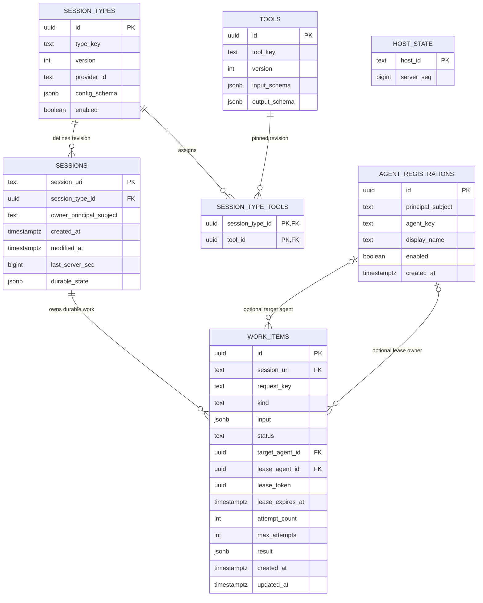
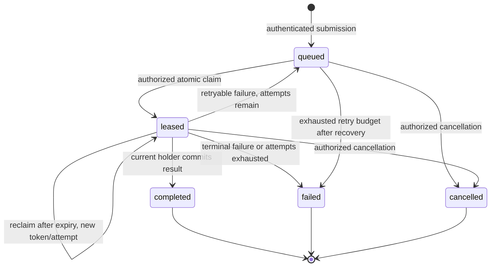

# Agent Hosting Protocol — M2 Agent Registration and Work-Lease Database Proposal

> **Status:** PROPOSED — reference schema only. **Not migrated, provisioned, or implemented.**
>
> **Repository:** [`spore310/AHP`](https://github.com/spore310/AHP), `develop` at `2f9900a65386f8ebc03feebc694c2c61c2b3c332` (verified 2026-10-19).
>
> **Intended repository location:** `database/M2_AGENT_WORK_DATABASE_SCHEMA.md`, adjacent to `database/session-tables.md`.
>
> **Dialect:** PostgreSQL **proposed**; adopting PostgreSQL is still a separate decision. All SQL below is illustrative and must be tested before it becomes authoritative.
>
> **Related task:** `docs/plans/M2_AGENT_IDENTITY_WORK_LEASING_TASKPLAN.md` (second handoff file).

## 1. Purpose and milestone boundary

Add the minimum **durable** data needed to identify independently running agents and assign, claim, renew, and settle long-running work. Preserve the live session registry, AHP connections, subscription sets, and advertised client tools as runtime concerns. Do not make a SQL row stand in for a WebSocket or a running Pi process.

`docs/plans/ProvidersPlan.md` currently defines **M2** as remote-client identity/presence: register an addressable agent, renew a **presence** lease, disconnect, and reclaim identity. It reserves full work delivery and coordination for **M4**. For this POC, the user has **explicitly proposed a narrow forward slice of M4**: durable work assignment and execution leases, without implementing a complete task scheduler or agent swarm. The task plan must label this expansion accurately.

**Two types of lease must never be confused:**

| Lease | Meaning | Source of truth now | SQL row? |
|---|---|---|---|
| **Agent presence lease** | A registered agent is *currently connected and addressable* | AHP host's in-memory presence manager, bound to the actual connection and authenticated principal | **No** — Redis may be considered later |
| **Work execution lease** | One authorized agent has the *current right to complete one durable task* | PostgreSQL `work_items` row, fenced by token, agent identity, status and deadline | **Yes** |

The server's WebSocket heartbeat is not sufficient proof of agent identity, and a `clientId` supplied during AHP initialization is not an authenticated principal.

## 2. Relationship to the existing proposals

The repository's present `database/session-tables.md` is **a three-table, unimplemented proposal**, not SQL already installed. It proposes `action_sequence`, `sessions`, `session_active_clients`. A subsequent accepted-in-conversation **five-table direction** uses `host_state`, `sessions`, `session_types`, `tools`, and `session_type_tools` to store durable state and immutable tool/type revisions. **Neither design is deployed.**

For the proposed M2/M4-slice schema, the *target* becomes **seven tables**:

| Table | Kind | Function |
|---|---|---|
| `host_state` | Existing five-table **target** | One logical host's persisted action-sequence checkpoint |
| `sessions` | Existing five-table **target** | Recoverable session identity, pinned type revision, safe projection, timestamps, sequence |
| `session_types` | Existing five-table **target** | Immutable/versioned application session-type definitions, provider ID |
| `tools` | Existing five-table **target** | Immutable/versioned serializable tool contracts |
| `session_type_tools` | Existing five-table **target** | Immutable type-revision-to-tool-revision membership |
| **`agent_registrations`** | **New for M2** | Stable addressable identity, principal binding, administrative enable/disable |
| **`work_items`** | **New for expanded M2** | Durable jobs, assignment target, claim/expiry/fencing, terminal results |

**Required reconciliation before writing migrations:** choose one canonical five-table base. Prefer the minimal durable-state design; do not create both `action_sequence` and `host_state`, do not duplicate session title/status fields without a proven read-model need, and **do not migrate `session_active_clients`**. The original design document is a *proposal*, so no legacy SQL needs to be dropped unless a real deployment is discovered.

One **additive column** is recommended on the future `sessions` table for this POC: `owner_principal_subject TEXT NOT NULL`, populated from the authenticated server context, not from client params. For initial M2, require agents working in a session to share its verified owner principal. Future cross-principal collaboration requires deliberate grants, not a workaround in the task schema.

## 3. Entity relationship diagram



**Notes:** `host_state` is a separate checkpoint, **not** a foreign key parent of `sessions`. The two associations between `agent_registrations` and `work_items` have distinct meanings: *target assignment* versus *current lease holder*. `session_types.provider_id` references a provider registered **in application code**, not a new `providers` table. The diagram is conceptual; SQL constraints are authoritative when implemented.

## 4. New table: `agent_registrations`

One stable identity for an independently running agent. This row survives a socket disconnect, host restart, and reauthentication. It does **not** mean the agent is presently alive or owns a local model process.

| Column | SQL type | Rules | Purpose |
|---|---|---|---|
| `id` | `UUID` | Primary key, generated server-side | Durable, opaque agent registration ID |
| `principal_subject` | `TEXT` | NOT NULL; derived from verified auth context | Identity allowed to reclaim this agent |
| `agent_key` | `TEXT` | NOT NULL; unique within principal | Stable logical name e.g. `coding-worker` |
| `display_name` | `TEXT` | Nullable, bounded by application | UI label only; not identity |
| `enabled` | `BOOLEAN` | NOT NULL DEFAULT TRUE | Disable registration from new claims |
| `created_at` | `TIMESTAMPTZ` | NOT NULL DEFAULT now() | Registration provenance |

`UNIQUE(principal_subject, agent_key)`: if the same authorized agent reconnects, resolve/reclaim the same row; do not create a duplicate. The server derives `principal_subject` from authenticated session identity, **never** from an AHP `clientId`, tool descriptor, or incoming request body. The SQL ID is not itself a credential.

Not stored: `connectionId`, `clientId`, socket URL, PID, heartbeat, lease expiry for online presence, live tool advertisements, credentials, access token, model/runtime configuration, executor implementation, or a claimed sandbox process.

## 5. New table: `work_items`

One row = one durable unit of requested work. A task remains independently identifiable even if its current worker disconnects. It is intentionally **not** a chat message, a WebSocket frame, a tool-call transcript, or a workflow DAG node yet.

| Column | SQL type | Rules | Purpose |
|---|---|---|---|
| `id` | `UUID` | Primary key | Work identity |
| `session_uri` | `TEXT` | NOT NULL FK `sessions(session_uri)` | Owning session and authorization scope |
| `request_key` | `TEXT` | NOT NULL, unique per session | Idempotent submission key |
| `kind` | `TEXT` | NOT NULL | Application-defined work kind, e.g. `code.patch` or `code.review` |
| `input` | `JSONB` | NOT NULL object, bounded/validated by app | Nonsecret task instructions + artifact references |
| `status` | `TEXT` | Checked allowed values; default `queued` | Durable work state |
| `target_agent_id` | `UUID` | Nullable FK `agent_registrations(id)` | Who work is *addressed to*, if any |
| `lease_agent_id` | `UUID` | Nullable FK `agent_registrations(id)` | Who currently owns execution rights |
| `lease_token` | `UUID` | Nullable; minted on each claim/reclaim | Fences old attempts; treat as sensitive |
| `lease_expires_at` | `TIMESTAMPTZ` | Nullable; DB clock | Last instant current attempt remains valid |
| `attempt_count` | `INTEGER` | NOT NULL DEFAULT 0, nonnegative | Increment on successful claim/reclaim |
| `max_attempts` | `INTEGER` | NOT NULL DEFAULT 3, positive | Limits retries |
| `result` | `JSONB` | Nullable, bounded by app | Small structured result/artifact references |
| `created_at` | `TIMESTAMPTZ` | NOT NULL DEFAULT now() | Submission timestamp |
| `updated_at` | `TIMESTAMPTZ` | NOT NULL DEFAULT now() | Last transition timestamp |

### Work state machine



A work item is **not simultaneously queued and leased**. For M2, allow one active execution lease per work item, not parallel executions. Retry is *at-least-once execution*, **not** exactly-once external side effects; stale results are fenced from commit, but a stale process may continue running unless sandbox controls stop it.

### Invariants

1. `status = 'leased'` **iff** `lease_agent_id`, `lease_token`, and `lease_expires_at` are all non-null. On every other state, all three are null.
2. `0 <= attempt_count <= max_attempts`; every claim increments `attempt_count` exactly once.
3. Only the current authenticated `lease_agent_id` holding the exact nonexpired token may renew or complete work; check expiry using the **database clock**, not a client timestamp.
4. A new claim/reclaim always mints a new token; old tokens cannot finalize a newer attempt.
5. `target_agent_id` is immutable after assignment for this first slice; change/retarget requires a controlled workflow transition, not a client editing an FK.
6. `UNIQUE(session_uri, request_key)` avoids duplicate task creation. A second submission with the same key must compare normalized immutable fields; if they differ, reject as conflict rather than overwriting.
7. Work eligibility (`kind`, target, owner principal, authorization) must be validated server-side; clients cannot elevate themselves by claiming an arbitrary kind or agent ID.
8. On completing/failing/cancelling, clear lease fields atomically; terminal states cannot be reclaimed.
9. `result` should describe the outcome or point to a bounded artifact; **do not store entire repositories, secrets, huge patches, or unbounded transcripts in JSONB**.
10. Never automatically execute stored task input. The worker runtime interprets work under its own sandbox and tool policy.
11. Session disposal with linked work is rejected until a deliberate work-cancellation and retention policy is implemented; no cascading deletion of active work.
12. Absence of a queued job is not proof an agent is offline. Runtime presence is held separately.

## 6. PostgreSQL reference DDL (not executed)

> Precondition: the five-table baseline has been selected and created, including `sessions(session_uri)`. The existing repository has **no actual database migration**. Do not execute this in an unknown production database. Choose transaction/migration order after settling `sessions` ownership and the database engine.

```sql
-- M2 reference / PostgreSQL. Creates exactly TWO new tables.
-- PostgreSQL's gen_random_uuid() is used; verify target engine/version.

CREATE TABLE agent_registrations (
  id UUID PRIMARY KEY DEFAULT gen_random_uuid(),
  principal_subject TEXT NOT NULL,
  agent_key TEXT NOT NULL,
  display_name TEXT,
  enabled BOOLEAN NOT NULL DEFAULT TRUE,
  created_at TIMESTAMPTZ NOT NULL DEFAULT now(),
  UNIQUE (principal_subject, agent_key),
  CHECK (length(trim(principal_subject)) > 0),
  CHECK (length(trim(agent_key)) BETWEEN 1 AND 128)
);

-- Session-owner column is part of the future baseline migration; for an
-- EXISTING deployed sessions table use a staged backfill and NOT NULL gate.
-- ALTER TABLE sessions ADD COLUMN owner_principal_subject TEXT NOT NULL;

CREATE TABLE work_items (
  id UUID PRIMARY KEY DEFAULT gen_random_uuid(),
  session_uri TEXT NOT NULL REFERENCES sessions(session_uri) ON DELETE RESTRICT,
  request_key TEXT NOT NULL,
  kind TEXT NOT NULL,
  input JSONB NOT NULL,
  status TEXT NOT NULL DEFAULT 'queued'
    CHECK (status IN ('queued', 'leased', 'completed', 'failed', 'cancelled')),
  target_agent_id UUID REFERENCES agent_registrations(id) ON DELETE RESTRICT,
  lease_agent_id UUID REFERENCES agent_registrations(id) ON DELETE RESTRICT,
  lease_token UUID,
  lease_expires_at TIMESTAMPTZ,
  attempt_count INTEGER NOT NULL DEFAULT 0 CHECK (attempt_count >= 0),
  max_attempts INTEGER NOT NULL DEFAULT 3 CHECK (max_attempts > 0),
  result JSONB,
  created_at TIMESTAMPTZ NOT NULL DEFAULT now(),
  updated_at TIMESTAMPTZ NOT NULL DEFAULT now(),
  UNIQUE (session_uri, request_key),
  CHECK (length(trim(request_key)) > 0),
  CHECK (length(trim(kind)) > 0),
  CHECK (jsonb_typeof(input) = 'object'),
  CHECK (result IS NULL OR jsonb_typeof(result) = 'object'),
  CHECK (attempt_count <= max_attempts),
  CHECK (
    (status = 'leased') =
      (lease_agent_id IS NOT NULL
       AND lease_token IS NOT NULL
       AND lease_expires_at IS NOT NULL)
  )
);

-- Start with two narrow claim/recovery indexes; profile before adding more.
CREATE INDEX work_items_queued_claim_idx
  ON work_items (session_uri, created_at, id)
  WHERE status = 'queued';

CREATE INDEX work_items_expired_claim_idx
  ON work_items (session_uri, lease_expires_at, created_at, id)
  WHERE status = 'leased';
```

**Schema constraints are not enough**: SQL alone cannot authenticate an AHP client, prove a lease's real owner, validate tool capabilities, or guarantee a sandbox. The application must enforce these invariants, and PostgreSQL role privileges must restrict direct writes to trusted host code. The `owner_principal_subject` addition is a required dependency for the **same-principal** policy in the reference claim query below.

## 7. Atomic claim, renewal, completion and recovery (reference SQL)

### 7.1 Claim or reclaim a work item

This is a **single statement** using row locks and `SKIP LOCKED`; do not implement `SELECT` followed by an unprotected `UPDATE`. Bind parameters safely. The authenticated caller's registration and approved work-kind set are supplied by trusted server code.

```sql
-- $1::uuid = server-verified agent registration ID
-- $2::text = authorized session URI
-- $3::text[] = kinds server policy permits this agent to perform
WITH candidate AS (
  SELECT w.id
  FROM work_items AS w
  JOIN sessions AS s ON s.session_uri = w.session_uri
  JOIN agent_registrations AS a ON a.id = $1::uuid
  WHERE w.session_uri = $2::text
    AND a.enabled = TRUE
    AND s.owner_principal_subject = a.principal_subject
    AND w.kind = ANY($3::text[])
    AND (w.target_agent_id IS NULL OR w.target_agent_id = a.id)
    AND w.attempt_count < w.max_attempts
    AND (
      w.status = 'queued'
      OR (w.status = 'leased' AND w.lease_expires_at <= statement_timestamp())
    )
  ORDER BY w.created_at, w.id
  FOR UPDATE OF w SKIP LOCKED
  LIMIT 1
)
UPDATE work_items AS w
SET status = 'leased',
    lease_agent_id = $1::uuid,
    lease_token = gen_random_uuid(),
    lease_expires_at = statement_timestamp() + INTERVAL '60 seconds',
    attempt_count = w.attempt_count + 1,
    updated_at = statement_timestamp()
FROM candidate
WHERE w.id = candidate.id
RETURNING w.*;
```

**Critical:** authorize the connection/agent/session relationship **before** entering this query. Verify live presence and the connection's currently bound registration; the SQL principal check is defense-in-depth for the initial same-principal POC, not a replacement for an authorization service. `SKIP LOCKED` improves contention handling but intentionally gives queue consumers an inconsistent view; it is not general-purpose consistent pagination. [PostgreSQL SELECT locking reference](https://www.postgresql.org/docs/current/sql-select.html).

### 7.2 Renew current work lease

```sql
-- $1::uuid = work item ID
-- $2::uuid = authenticated agent registration ID
-- $3::uuid = last-issued lease token (sensitive)
UPDATE work_items
SET lease_expires_at = statement_timestamp() + INTERVAL '60 seconds',
    updated_at = statement_timestamp()
WHERE id = $1::uuid
  AND status = 'leased'
  AND lease_agent_id = $2::uuid
  AND lease_token = $3::uuid
  AND lease_expires_at > statement_timestamp()
RETURNING id, lease_expires_at;
```

A zero-row result means denied/expired/not-owned; never renew from an unverified `agentId` body. If authorization is revoked after claim, the service must also block renewal/completion; the database query only verifies token and registered ID.

### 7.3 Complete current work lease

```sql
-- $1::uuid = work item ID
-- $2::uuid = authenticated agent registration ID
-- $3::uuid = current lease token
-- $4::jsonb = validated bounded completion result
UPDATE work_items
SET status = 'completed',
    result = $4::jsonb,
    lease_agent_id = NULL,
    lease_token = NULL,
    lease_expires_at = NULL,
    updated_at = statement_timestamp()
WHERE id = $1::uuid
  AND status = 'leased'
  AND lease_agent_id = $2::uuid
  AND lease_token = $3::uuid
  AND lease_expires_at > statement_timestamp()
RETURNING id, status, result, updated_at;
```

A zero-row completion is not success. The service should distinguish `not found`, `unauthorized`, `expired`, `already terminal`, and `stale token` internally; public errors must not disclose another principal's work.

### 7.4 Expired attempt budget and retryable failures

```sql
-- Reconciliation: terminalize expired work that exhausted its attempts.
UPDATE work_items
SET status = 'failed',
    lease_agent_id = NULL,
    lease_token = NULL,
    lease_expires_at = NULL,
    updated_at = statement_timestamp()
WHERE status = 'leased'
  AND lease_expires_at <= statement_timestamp()
  AND attempt_count >= max_attempts;
```

For an explicitly reported *retryable* failure, use a fenced, authorized update that sets `status='queued'` if attempts remain (otherwise `failed`) and clears the current lease fields. Reclaiming an expired lease with budget remaining happens in the atomic claim statement. Never use an unfenced whole-table update to reassign a currently valid lease. No periodic scheduler needs to be introduced: reconciliation can run on host startup, eligible-work queries, and claim attempts.

## 8. Runtime presence and interaction with AHP

```text
Authenticated connection  ->  in-memory presence { agentId, principal, connectionId, generation, expiresAt }
         |                           |
         | renews/disconnects        | eligible, uniquely addressable
         v                           v
     M2 presence             Work claim API
                                     |
                                     v
                          PostgreSQL work_items lease
                                     |
                                     v
                     Independently running worker executes
```

- Build an **in-memory** agent presence manager. Renew/reclaim the presence lease through a versioned `x-ahp/...` extension; the exact methods must be frozen in the task plan before code. A claimed `clientId` is not authorization; one active `agentId` belongs to at most one live bound connection. Duplicate registrations either fail while a lease is live or follow a deliberately approved takeover policy. Use a generation/connection check to reject stale close callbacks and old messages.
- Current `SessionState.activeClients` describes per-session client participation and tool advertisements. Do not synthesize agent registration SQL rows from those actions. A persistent agent can be offline and a connected AHP client may not be a registered worker.
- Store queued/leased work in PostgreSQL; **do not** store socket IDs, online timestamps, WebSocket subscriptions, or per-client tool inventories in `work_items` or `agent_registrations`.
- Preserve the current `x-ahp/tools/*` bridge for short synchronous client tool calls. **Work items are durable assignments** and may run for minutes, require evaluation, or survive reconnects. They must not be implemented by simply waiting on the existing 30-second tool-call promise.
- A work-available notification is merely a hint; workers must be able to query/claim work after a lost notification or server restart. No exactly-once delivery claim.

## 9. Failure scenarios required before adopting

| Scenario | Expected durable behavior |
|---|---|
| Two eligible workers race to claim one row | Exactly one fresh lease is committed; other receives no claim |
| Agent disconnects after claim | Presence goes offline; work remains leased until expiry, then claimable by policy |
| Host crashes after assigning work | New host reads row, retains attempt and original expiry; worker reconnects/reclaims identity |
| Lease expires and work is claimed again | Token rotates; previous holder cannot renew/complete |
| Old executor keeps writing to filesystem | SQL rejects stale completion, **but** sandbox fencing / isolated worktree is needed to prevent side effects |
| Duplicate submission, same key/same normalized payload | Return existing work ID, do not create another row |
| Duplicate submission, same key/different payload | Conflict; preserve original input and target |
| Unauthorized client forges agent key or work ID | No registration/claim/renew/result access |
| Agent disabled after claim | Further renew/completion denied; recovery through expiry/cancel policy |
| Session disposal while work exists | Reject or orchestrate explicit cancellation according to an accepted retention policy; never silently cascade active work |
| Restart with stale `activeClients` in a saved session snapshot | Do not restore live client presence from SQL |
| Process dies after work completion commit, before event delivery | Result remains retrievable; no claim that every notification was delivered |
| Empty queue with an online agent | No work assignment; connection remains online |

## 10. Deferred by design

No SQL `agent_leases`, `agent_presence`, `session_active_clients`, socket, subscription, tool-invocation or connections table. No Redis now, no full workflow DAG, no dependent-task table, no event-sourced journal, no server-side Pi/model executor, no sandbox management table, no chat/terminal tables, no secret/token vault, no untrusted-network deployment. Real authorization is a prerequisite for remote agent registration; do not replace it with a pretend admin role.

## 11. Ownership and next steps

- `database/*.sql`: **future authoritative** DDL/migrations after DB selection, including seven-table reconciliation.
- `src/sessions/`: continues to own AHP session state; do not swap synchronous `SessionRegistry` with SQL calls.
- Proposed `src/agents/` or `src/presence/`: stable agent registration policy plus ephemeral connection presence.
- Proposed `src/work/`: work domain, claim/lease/complete transitions and bounded public DTOs.
- Proposed `src/persistence/`: asynchronous PostgreSQL repository implementing work and durable-session ports; no parallel ORM-owned schema.
- `src/websocket/helpers/ahp/`: validated custom wire entrypoint, authenticated principal injection, publish hints, not SQL business rules.
- `src/toolClient/`: later optional client wrapper for agent registration, work claim/renew/result. No Pi SDK dependency in server.

**Sources:** [current AHP implementation](https://github.com/spore310/AHP/tree/2f9900a65386f8ebc03feebc694c2c61c2b3c332), [M2/M4 boundaries](https://github.com/spore310/AHP/blob/2f9900a65386f8ebc03feebc694c2c61c2b3c332/docs/plans/ProvidersPlan.md), [five-table future handoff](https://github.com/spore310/AHP/blob/2f9900a65386f8ebc03feebc694c2c61c2b3c332/docs/plans/tools%20and%20session%20types/FUTURE_PERSISTENCE.md), [PostgreSQL row locks](https://www.postgresql.org/docs/current/sql-select.html).
