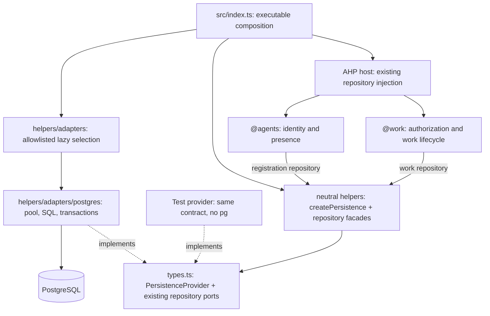

# Task plan — Database- and ORM-agnostic persistence

**Mode:** implementation handoff only; no repository edits performed in preparing it.
**Target:** `spore310/AHP`, branch `agentIdentity`.
**Reviewed checkpoint:** `f2804963129403e666a6e929db92beb9b2ab761d`.
**Design revision:** R2; two sequential author-review passes completed for the plan.
**Executor:** user's configured GLM 5.3 Flash runner, one packet at a time.

## 1. Outcome

Keep the current repository pattern and use `src/persistence/types.ts` as the
contract. Expose a small ORM-like, domain-oriented return object. Convert the
current neutral helpers into facades that consume the common contract. Move
all PostgreSQL/driver/SQL behavior beneath
`src/persistence/helpers/adapters/postgres/`. Update all connecting production
modules and relevant tests, not just the persistence folder.

A successful refactor lets an application replace its persistence provider
without changing agent identity, work leases, sessions, or AHP request handling.
It does not guarantee every database supports the required semantics. An adapter
that cannot implement the lease/transaction contract must not advertise itself
as supported.

The spelling is `persistence` and `postgres`. Do not create parallel misspelled
modules or new `@persistance` aliases.

## 2. Read order and packet discipline

Start with [CORE_CONTRACT.md](CORE_CONTRACT.md), then
[packets/P00.md](packets/P00.md). After that, open only the current packet, its
required source files, and prior handoff evidence. The core contract is the
single design authority; packet checklists do not redefine it.

[GLM_EXECUTION_PROMPT.md](GLM_EXECUTION_PROMPT.md) is the runner prompt.
[ACCEPTANCE_MATRIX.md](ACCEPTANCE_MATRIX.md) is the verification inventory.
[templates/HANDOFF.md](templates/HANDOFF.md) is the per-packet output shape.
[SOURCE_EVIDENCE.md](SOURCE_EVIDENCE.md) identifies inspected source and primary
technical references. No benchmark, context-window, price, or proprietary goal
syntax is assumed for the selected model.

## 3. Why this is more than a folder move

Observed at the checkpoint:

| Current boundary | Evidence | Refactor obligation |
| --- | --- | --- |
| Repository ports are already plain async TypeScript | `src/persistence/types.ts` | Preserve them; add a grouping/lifecycle contract |
| Root exports include concrete PostgreSQL constructors | `src/persistence/index.ts` | Remove transitive vendor dependencies from neutral imports |
| Pool, transactions, row shapes, SQL and errors use `pg` | `helpers/pool.ts`, `agentRegistrations.ts`, `sessions.ts`, `workItems.ts` | Move all of this into the PostgreSQL adapter |
| Work submit shares a transaction with session ensure | `helpers/workItems.ts: submit` | Keep this operation atomic inside the adapter |
| Agents/work/wire import JSONB-shaped validation | `agents/helpers/directory.ts`, `work/helpers/helpers.ts`, `websocket/helpers/ahp/agentWork.ts` | Replace with a deliberate neutral portable-text policy |
| Process wiring allocates a Pool and calls pool.end | `src/index.ts: createAgentWorkOptions` | Select a provider and consume only its common object |
| Host/work already accept repository interfaces | `work/types.ts`, `websocket/helpers/host/types.ts` | Preserve those seams; do not spread provider awareness |
| Real PostgreSQL tests are explicitly blocked | `src/persistence/README.md` | Preserve the authorization/evidence boundary |

The neutral facades own admission/draining and a safe error boundary. They do
not reconstruct database algorithms. This avoids adding wrappers whose only
purpose is to rename a library call.

## 4. Target dependency graph



These are composition/dependency relationships, not database call routing arrows.
At runtime facade operations delegate to the selected provider. The AHP host is
not made dependent on the adapter registry.

### The public usage we are targeting

```ts
// Application composition; proposed API, not current repository code.
import { createPersistence } from '@persistence';
import { createConfiguredPersistenceProvider }
  from '@persistence/helpers/adapters';

const provider = await createConfiguredPersistenceProvider({
  provider: configuredProvider,
  options: configuredProviderOptions,
});
const persistence = createPersistence(provider);

// Supply the existing ports, not the raw provider, to domain services.
const registrations = persistence.registrations;
const workRepository = persistence.work;
const durableSessions = persistence.sessions;

// At the single owning shutdown boundary:
await persistence.dispose();
```

A future ORM-backed adapter can implement the same three repository namespaces
with its own primitives. This task implements only the PostgreSQL adapter and a
non-production fake for substitution tests. It does not design a generic ORM DSL.

## 5. Exact migration map

| Existing path/symbol | Target responsibility |
| --- | --- |
| `src/persistence/types.ts` | Existing DTOs/ports/errors + `PersistenceRepositories` and `PersistenceProvider` |
| `src/persistence/index.ts` | Neutral public exports; no adapters or `pg` types |
| `helpers/pool.ts` | Move pool/transactions/mapping/error translation to `helpers/adapters/postgres/helpers/connection/`; remove old file |
| `helpers/agentRegistrations.ts` | Move SQL into postgres adapter; replace old file with `createAgentRegistrationRepository` neutral facade |
| `helpers/sessions.ts` | Move row mapping, SQL and internal transaction-local ensure into adapter; old file becomes `createDurableSessionRepository` facade |
| `helpers/workItems.ts` | Move all SQL and transactional units into adapter; old file becomes `createWorkRepository` facade |
| `helpers/text.ts` | Owned portable-text profile and neutral names; no PostgreSQL imports or names |
| new `helpers/provider/` | Compose common lifecycle and neutral repositories |
| new `helpers/lifecycle/` | Admit/drain/dispose once; safe error containment |
| new `helpers/adapters/` | Explicit lazy provider selection; names/options validation |
| new `helpers/adapters/postgres/` | Concrete provider factory and private PostgreSQL implementation |

For exact folder/file names, use C04 in the core contract. `index.ts` remains the
public export boundary, not an executable implementation dump.

## 6. Connecting modules are part of the task

| Consumer | Required change | Preserve |
| --- | --- | --- |
| `src/agents/helpers/directory.ts` | Neutral public repository types and portable text helper | Agent registration, generation fencing, presence TTL/cache behavior |
| `src/agents/types.ts` | Public contract imports only | Principal and directory signatures |
| `src/work/helpers/helpers.ts` | Neutral helper/error imports and wording | Ownership, validation limits, claim/renew/complete semantics |
| `src/work/types.ts` | Public contract imports only | Existing repository injection |
| `src/work/index.ts` | Remove JSONB-named re-export; export only work API | Existing work limits and service exports |
| `src/websocket/helpers/ahp/agentWork.ts` | Neutral validation imports; no JSONB wording | v1 schemas, bounds and wire error codes |
| `src/websocket/helpers/host/types.ts` | Consume public neutral repository interfaces | `agentWork` option shape |
| `src/websocket/helpers/host/helpers.ts` | Import audit only unless required wiring changes | Session-owner projection, settlement guard, presence/work services |
| `src/index.ts` | Async provider selection + facade injection + single disposer | Feature flag behavior, auth checks and baseline host |
| `env/types.ts`, `env/README.md` | Neutral optional selector + documented config table | Existing variables and limits |
| matching tests and fixtures | Replace source imports and update async startup mocks | Existing meaningful assertions and fake-port seams |

This is the initial inventory, not a claim that remembered imports are complete.
P00 must search the actual worktree for every `@persistence`, relative persistence
import, `createPostgres`, `Pool`, `isJsonbSafe`, and JSONB-related error assertion.
Resolve newly discovered callers before final cleanup. Do not edit unrelated
features because they appear in the same file.

## 7. Packet dependency map

| Packet | Outcome | Depends on |
| --- | --- | --- |
| [P00](packets/P00.md) | Baseline, inventory, evidence and scope | None |
| [P01](packets/P01.md) | Shared provider contract frozen | P00 |
| [P02](packets/P02.md) | Neutral text policy with characterization tests | P01 |
| [P03](packets/P03.md) | PostgreSQL connection/transaction boundary | P01 |
| [P04](packets/P04.md) | PostgreSQL registration/session repositories moved | P03 |
| [P05](packets/P05.md) | PostgreSQL work repository moved intact | P04 |
| [P06](packets/P06.md) | Complete provider + lazy adapter registry | P05 |
| [P07](packets/P07.md) | Neutral operation/disposal scope | P01 |
| [P08](packets/P08.md) | Neutral facades; legacy root exports temporarily tracked | P02, P06, P07 |
| [P09](packets/P09.md) | Domain/wire consumers migrated | P08 |
| [P10](packets/P10.md) | Async composition, config and final root-export cleanup | P09 |
| [P11](packets/P11.md) | Substitution, boundary and semantic conformance gates | P10 |
| [P12](packets/P12.md) | Scoped docs, full validation, final evidence | P11 |
| [P13](packets/P13.md) | Two final review passes and handoff | P12 |

Default: sequential execution. With two terminals, use one writer and one
read-only reviewer. After P01 freezes, P02 and P07 can be prepared independently
of P03–P06 **only in separate worktrees with agreed write ownership**. P08 is the
integration barrier. Never run two mutating agents against shared `types.ts`,
`index.ts`, env files, or the same checkout.

During P08–P09 the existing concrete root exports are temporarily redirected to
the moved adapter implementations so the entrypoint continues to typecheck.
P10 removes them in the same candidate that migrates process composition.
Do not run or claim the final root-import isolation gate before this switch.
Mark the temporary debt in every intervening handoff. Final gates forbid
old concrete exports/shims. Every packet must leave typechecking usable or record
the exact documented intermediate dependency; don't suppress errors.

## 8. Constraints and non-goals

- No database provisioning, live DB reads, migrations, seed writes, or schema
  changes without separate explicit authorization. The current task is a plan.
- No new production database/ORM, dependencies, broker, Redis, service, agent
  runtime, filesystem executor, chat/terminal capability, or task scheduler.
- No mutation of `SessionRegistry` into an async database repository.
- No persistence of connection/presence state, new automatic restoration, or
  new promises of complete durable session recovery.
- No splitting atomic work operations into independent generic calls.
- No public transaction callback or `query(sql)` method; add one only for a
  future demonstrated use case with separately reviewed semantics.
- No mass file renaming outside the selected persistence/import/docs scope.
- No push, merge, deploy, credential exposure, or automatic model/account switch.

The user selected the provider architecture. Treat that as target intent;
existing plans that predate this request must be qualified, not silently treated
as an alternative implementation mandate.

## 9. Verification strategy

Each packet provides focused checks. The integrated required repository command
is `pnpm validate`, which runs lint, typecheck, tests, docs coverage and build.
Use the pinned toolchain and current manifest; do not upgrade packages to work
around an environmental mismatch.

Three evidence categories must remain separate:

1. **Neutral substitution proof:** fake providers, facade behavior, module graph,
   same WorkService/AgentDirectory/host APIs; no SQL required.
2. **PostgreSQL adapter source/unit proof:** unchanged SQL/parameters, one
   transaction client, row mapping and safe errors through a query double.
3. **Real database proof:** independently scheduled concurrent transactions,
   expiry/reclaim, rollback and contention on an explicitly authorized test DB.

Only category 3 can establish actual database locking and transaction behavior.
Do not mark it passed because tests with fake ports passed. Record BLOCKED / NOT
RUN while permission or infrastructure is absent.

## 10. Review record

Two plan reviews are delivered, not just templates:

- [Review 1](reviews/REVIEW_1_ARCHITECTURE.md): boundaries, scope, consumer mapping,
  contract shape, imports and minimality.
- [Review 2](reviews/REVIEW_2_CORRECTNESS.md): transaction affinity, leases,
  sanitization, shutdown, substitution and evidence quality.

They are sequential self-reviews by the author. No independent agents were
launched and no double-blind independence is claimed. Final implementation review
is a separate packet and must examine the actual patch rather than these reports.

## 11. Acceptance and stop condition

Code-level completion requires the final tree to pass the neutral dependency
checks, all applicable unit/integration checks, docs coverage and build, with
no pending required review finding. PostgreSQL DDL must remain unchanged.

When real DB execution remains unauthorized, the truthful terminal status is:
**IMPLEMENTED / DATABASE ACCEPTANCE BLOCKED**, with the precise unrun cases.
Do not write “all adapters verified,” “production portable,” or “database
agnostic” as an operational certification based solely on type compatibility.

The delivery from this chat is **PLAN READY** only. None of the above proposed
code has been applied to GitHub.
