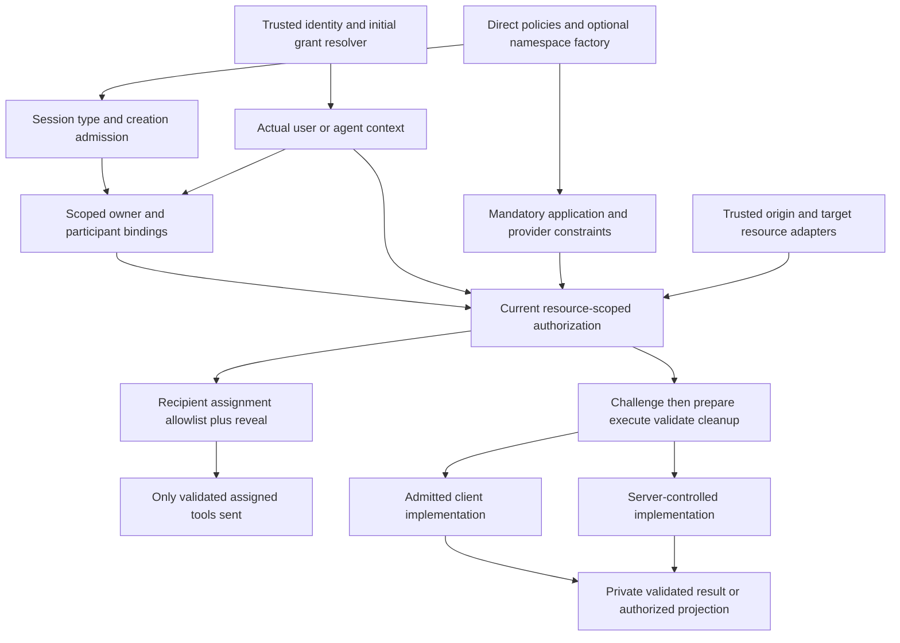

# R5 master implementation plan

**Target:** Agent Hosting Protocol SDK on `agentIdentity`.
**Base:** `22fa7955b8e43839e041228f647f26e00762ebbe` — `fix: close persistence review findings`.
**Mode of this delivery:** Markdown implementation handoff. No code changed or tested.
**Execution:** user-authorized local Grok runner; one bounded packet at a time.

## 1. Outcome and decisions

Implement application-owned role/policy vocabulary, trusted initial and scoped grant
issuance, optional compositional namespaces, provider/resource restrictions, private
assigned-tool delivery and one authoritative execution lifecycle. Preserve existing
immutable tool schemas, session backend lifecycle, connection correlation and durable
work fences. See [intent](INTENT_AND_DECISIONS.md) and [contract card](CONTRACT_CARD.md).

Ownership and roles share one trusted subject/domain source, but are not the same
fact. Replace the global application role as an authority source; never impersonate
the owner to authorize an invited user. A reusable coding-agent implementation is
not a reusable user credential or shared role cache. Role strings and role arrays
have no built-in defaults. A name such as workspace.review@pm is an opaque registered
policy ID, not an authentication or resource hierarchy shortcut.

Application policies control reveal; the SDK independently checks its canonical
admission/assignment allowlist and all resource/provider requirements. A permissive
callback cannot send an unassigned or unregistered tool. Session/chat/terminal/
workspace origin and target rules compose through trusted relationships. Only
sessions and tools exist as implemented resources in this milestone; other resource
kinds are port contracts and test adapters, not actual terminals or chat services.

## 2. Read efficiently

Read CONTRACT_CARD.md and the assigned packet. Load only its linked contract and
source files. Full contract documents are authoritative; packet summaries do not
redefine semantics. Do not repeatedly load the full package, logs or conversation.
The [test coverage matrix](TEST_COVERAGE.md) maps every criterion to an owner packet
and a distinguishing check. [TEST_RUNBOOK.md](TEST_RUNBOOK.md) defines the test method.

## 3. Packet sequence

| Packet | Single delivery outcome | Dependencies |
| --- | --- | --- |
| [P00](packets/P00.md) | Source baseline, installed SDK inspection and complete ingress/egress map | None |
| [P01](packets/P01.md) | Shared portable authority/execution contracts and schema limits | P00 |
| [P02](packets/P02.md) | Direct-policy and compositional namespace factory | P01 |
| [P03](packets/P03.md) | Scoped bindings and policy evaluation/assignment allowlist | P02 |
| [P04](packets/P04.md) | Host initialization security independent of durable work | P03 |
| [P05](packets/P05.md) | Session-type admission and atomic owner bootstrap | P04 |
| [P06](packets/P06.md) | Bounded assignment/delegation, revocation and freshness | P05 |
| [P07](packets/P07.md) | Relocate tool client under toolExecution without duplicate runtime | P06 |
| [P08](packets/P08.md) | Class action lifecycle, canonical input and safe cleanup | P07 |
| [P09](packets/P09.md) | Existing tool broker and implementation admission use dispatcher | P08 |
| [P10](packets/P10.md) | Recipient-safe native projections and every outbound path | P09 |
| [P11](packets/P11.md) | Versioned private assignments, invocation and client API | P10 |
| [P12](packets/P12.md) | Real SDK multi-client security integration checkpoint | P11 |
| [P13](packets/P13.md) | Challenge begin/verify/resume with bounded continuation | P12 |
| [P14](packets/P14.md) | Resource adapters and authorized result projection | P13 |
| [P15](packets/P15.md) | Server-controlled executor using the same lifecycle | P14 |
| [P16](packets/P16.md) | Client contract proposal/approval and publishing authority | P15 |
| [P17](packets/P17.md) | Approved-artifact descriptor/verifier/transport seam | P16 |
| [P18](packets/P18.md) | Consumer examples and factual documentation migration | P17 |
| [P19](packets/P19.md) | Full acceptance coverage, integrated tests and completion evidence | P18 |

P00–P06 establish authority; P07–P12 integrate the existing client-execution path;
P13–P15 complete lifecycle/resource/server execution; P16–P17 add admission and
artifact extension points; P18–P19 finish documentation and validation.

The sequential order is deliberate for one subscription and one writer. Do not
parallel-edit shared contracts or transport files. A packet may be split into
smaller local checkpoints without changing its public contract or acceptance.
No intermediate snapshot may be described as safe for untrusted multi-user use.

## 4. Proposed public usage shape

```ts
// Consuming application composition — proposed SDK surface.
const policies = createToolPolicyFactory({
  policies: directPolicies,          // namespaces optional
  namespaces: declaredNamespaces,
  sessionTypes: sessionPolicyBindings,
});

const host = createAHPServer({
  host: '127.0.0.1',
  port: configuredPort,
  security: applicationSecurityAdapter,
  sessions: {
    providers: configuredSessionProviders,
    application: createApplication({ policyManifest: policies.buildManifest() }),
  },
  toolExecution: configuredExecutionServices,
});
```

These are target composition names, not existing exports. P01 defines the exact
portable option types; later packets implement them. No domain roles, ORM, MFA UI,
filesystem or model runtime belongs in the SDK's mandatory public contract.

## 5. Authority and execution diagram



## 6. Scope constraints

No database migration/query/provisioning, new ORM or authentication vendor, external
agent API, generated app, dependency upgrade, GitHub writes, push/merge/deployment,
real PTY, chat streaming, filesystem mounts or unrestricted downloadable-code runner.
Keep @persistence and current owner-only @work semantics intact. A new role is not
permission to bypass their same-principal repository checks.

The artifact packet supplies metadata/verifier/transport/runtime-loader ports and
fake integration proof only. The consumer implements its own real artifact runtime
or sandbox. A matching hash is not remote execution attestation. No broad installer
format or supply-chain ecosystem is included.

## 7. Completion evidence

Every packet returns a factual handoff and updates the ledger. All acceptance rows
start NOT RUN. Run focused checks while iterating; follow repository `pnpm validate`
requirements for completed changes and at each milestone. Tests of fake resource
adapters prove policy wiring, not actual filesystem, terminal or MFA behavior.

Final completion requires implemented scoped gates, every metadata path checked,
actual pinned SDK client/reducer integration, no unguarded compatibility path,
source-mapped docs and a passing final repository gate on the exact candidate.
Record current limitations and unrun external integrations explicitly. Test
existence, a TypeScript shape and a historical 407-test commit report are not a new
runtime pass. The plan does not request independent review agents or review files.
