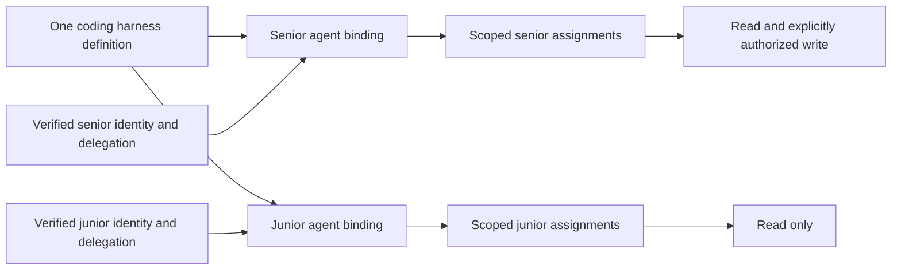
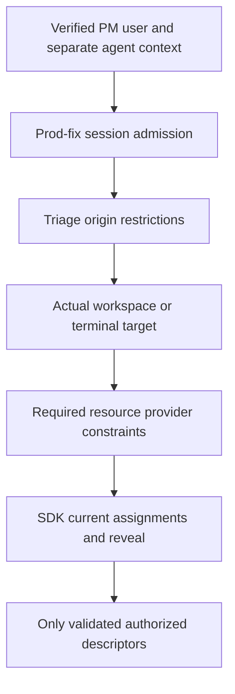

# Worked policy scenarios and expected assertions

All roles, policy names and resource IDs below are **application-defined test
fixtures**, not default SDK roles or built-in domain semantics.

## 1. Senior and junior use the same coding harness

Setup: one organization/security domain; senior subject S and junior subject J;
one immutable `coding-harness-v1` definition; separately verified agent bindings
AS and AJ. S is the creator of a session whose explicit type bootstrap assigns
local administrative policies. J has a limited contributor binding. Both see an
approved read tool; only S/AS receives the separately authorized write assignment.

Expected: AS and AJ use identical implementation code but different authority.
Listing and invoking reflect the actual user/delegation, agent and resource route.
AJ cannot copy AS's clientId, role, continuation or implementation ID to obtain a
write grant. AS's result/cache must never become AJ's response. The server executor's
own service credential is not the caller identity. The session owner remains S
when J is authorized to read. Coverage: A06, S01, G05, X01, E04.

## 2. PM in a production-fix session and triage chat

Setup: PM user U and their independently classified agent AU are admitted to
session S and triage chat C. The session's tool ceiling includes production write,
but C admits only inspection and summary. Workspace W requires its own provider
approval for writes. AU receives only the explicit delegated subset of U's scope.

Expected: the SDK sends U/AU only their assigned revealable descriptors. Being in S
or C does not authorize terminal input, write, tool replacement or publication.
A guessed write key still denies. A reveal callback returning true for write cannot
manufacture an assignment. An explicit policy might authorize U but not AU, even
though the agent belongs to U. Coverage: A04, A05, T01, V02, X02, R01, R02.

## 3. Session owner is not a global administrator

Setup: the creator can create an ordinary review session and receive its local
owner binding. A production-emergency type has a separate creation/bootstrap rule.

Expected: attempting to create the emergency type without the required grant is
rejected before owner powers exist. Local owner authority in S1 does not affect S2,
the host, another user's identity or provider-owned secrets. A role named `admin`
has only the meanings registered in that application/scope. Coverage: S02, A02, G01.

## 4. Provider refuses despite application permission

Setup: application grants `workspace.read`; the provider denies a protected target
resolved from canonical input, or the provider evaluator is required but absent.

Expected: no prepare or execute callback, no raw tool/resource details in a public
error and no fallback to another executor. Distinct application/provider role labels
are evaluated independently, not mechanically intersected. Coverage: A02, R03, E01.

## 5. Grants after initialization and parent revocation

Setup: a participant connects with zero tool grants, then receives a trusted
session-scoped binding from an authorized issuer. The participant delegates a
smaller explicit subset to its agent. Later the parent grant is revoked.

Expected: first view empty; second view contains only assigned/revealable tools;
agent never inherits undelegated user roles. Child authority becomes unusable when
parent is revoked, including queued descriptors and an awaited policy decision.
No role cache keyed solely by model name survives. Coverage: G01–G05, V04, T03.

## 6. Private descriptor delivery and exact local advertisement

Setup: one approved client implementation; a second observer lacks that contract's
discovery grant. Executor stages handlers then sends its private advertisement.

Expected: private reply contains exactly the accepted normalized set for the
executor. Only then does it activate. Native observer snapshots/actions contain no
hidden schema. Rejected/stale acknowledgement preserves the prior handler set.
Actual Microsoft client state remains coherent. Coverage: M02, V02, V05, W02.

## 7. Changed input during validation or challenge

Setup: input initially requests a harmless path. Custom normalization changes the
actual target; or a resume request tries to replace a previously approved target.

Expected: normalized canonical input is schema-checked and authorized against the
actual target before prepare. Continuation does not accept replacement input. Changing
executor, policy revision or session incarnation invalidates the old approval.
Coverage: L03, C03, S04.

## 8. Client disconnects while an action is running

Setup: a server action has acquired a resource and ignores the abort signal until
a deferred operation settles. The caller disconnects or loses permissions.

Expected: no new result delivery after revocation, no automatic retry, no resource
release while still in use and no artificial free capacity for the draining action.
When it settles, all cleanup runs once. Already completed external effects are not
claimed rolled back. Coverage: L05–L08, T06, R05.

## 9. Same public URI reused

Setup: S(old) creation or challenge is pending; S(old) is disposed and S(new) uses
the same URI and perhaps the same creator subject.

Expected: instance IDs differ. Old grant/challenge/admission/cleanup cannot bind,
authorize or unbind S(new). A public URI alone is not authority. Coverage: S04, C03.

## 10. Shared resource associated with two sessions

Setup: a terminal has an independent owner/provider and is linked to S1 and S2.
A caller has observation in S1 and a stronger but unrelated role elsewhere.

Expected: the selected origin route and trusted relationship are validated; all
terminal restrictions remain mandatory. Forging a permissive parent does not allow
input or termination. Coverage: R01–R03. These use fake resources, not a real PTY.

## 11. Client proposal and approved artifact

Setup: a client can propose but not approve/publish; an authorized publisher later
submits a descriptor for a separately approved artifact. The artifact has inert test
bytes and an injected fake loader.

Expected: proposal alone never appears in assignments. An explicit approver cannot
silently widen existing sessions. An unassigned recipient receives neither artifact
locator nor bytes. Wrong digest/revision fails before loading; a successful local
verification report is not server proof of honest execution. Coverage: Q01–Q04,
F01–F04. No code download/eval or installer is needed.

## 12. Existing owner-only work remains narrower

Setup: J is authorized to use a tool in S-owned session, then asks the current
WorkService to claim owner-only work under J's own principal.

Expected: existing work service/repository guard still denies. The SDK must not
substitute S's subject or remove SQL predicates to fake delegated work support.
Tool authorization and work assignment are separate capability contracts. Coverage: G06.
