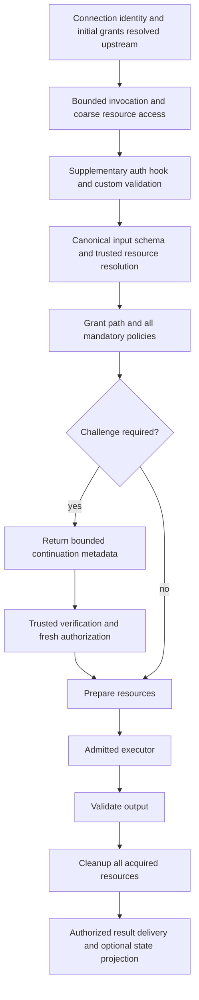

# Authoritative execution lifecycle and continuation

**Target contract, R5.** The transport calls one dispatcher. The action implements
behavior but cannot reorder SDK security gates. No framework, OS or ORM is assumed.

## E1. Class surface and canonical input

```ts
// ./src/toolExecution/types.ts — proposed
export type Awaitable<T> = T | Promise<T>;
export type ValidationResult<TInput> =
  | void
  | { readonly kind: 'normalized'; readonly input: TInput };

export interface ToolPreparationHooks {
  onCleanup(callback: () => Awaitable<void>): void;
}

// ./src/toolExecution/helpers/action/helpers.ts — proposed
export abstract class ToolAction<TInput, TOutput, TPrepared = void> {
  authenticate?(context: ToolActionContext, input: TInput): Awaitable<void>;
  validate?(input: TInput, context: ToolActionContext): Awaitable<ValidationResult<TInput>>;
  prepare?(input: TInput, context: ToolActionContext, hooks: ToolPreparationHooks): Awaitable<TPrepared>;
  abstract execute(input: TInput, context: ToolActionContext, prepared: TPrepared | undefined): Awaitable<TOutput>;
  cleanup?(context: ToolActionContext, prepared: TPrepared | undefined): Awaitable<void>;
}
```

`ToolActionContext` includes only needed trusted actor/caller, resolved resources,
exact contract/implementation identity, call ID and AbortSignal. It does not expose
mutable grants, a raw socket, framework request or a mutable SessionRecord.

No separate `validated` parameter reaches prepare. The one input is schema-checked,
optionally normalized, then revalidated/reauthorized before effects. Validation
return values cannot grant authority. Generic prepared values may be callbacks or
resource handles, but remain local memory; never serialize executable callbacks.

Optional prepare makes prepared possibly undefined. Do not cast it to non-null
for a generic action. A consumer needing required preparation must implement it
and narrow/check that value or use a typed factory enforcing that requirement.
Construct an action per invocation by default, or require a documented stateless
implementation; do not share per-call mutable state between two users' requests.

## E2. Ordering



Reject oversized/malformed input before hooks. Coarse access avoids expensive
custom validation on hidden resources. Run the optional authentication hook only
as supplemental application validation; it cannot replace initialized identity or
widen grants. If it needs step-up it declares that condition through the challenge
adapter, not a self-approved boolean. Do not perform privileged preparation there.

If normalization changes a path/target, resolve the new canonical resource and
recheck every relevant policy. Freeze/capture input used for authorization. No
post-check mutation can redirect execution. Schema validation may be absent in a
contract's output; preserve existing semantics unless the registration explicitly
requires an output schema. Raw executor output is never treated as a trusted action.

Every invocation pins contract, implementation, resource incarnation and security
revision. Revalidate immediately before dispatch and before sensitive result
release/commit. No silent rerouting or reexecution on revocation/disconnect.

## E3. Cleanup, errors and cancellation

Register each cleanup immediately after acquisition. On failed prepare, execute,
output validation or cancellation, attempt registered callbacks in reverse order;
call optional action cleanup in a documented stable order (action cleanup before
registered resource callbacks, so it can use prepared resources). Attempt all even
when one fails. Each runs once per dispatcher-owned lifecycle. Preserve a primary
failure; attach only sanitized cleanup diagnostics. Successful execution followed
by cleanup failure is not a safe automatic retry—side effects may already exist.

Cancellation is cooperative via AbortSignal. A transport timeout settles the
client-facing wait but does not forcibly end running JavaScript or a remote client.
Do not free a resource while an unsettled operation can still use it. Track draining
ownership until the action settles or its runtime-specific abort contract proves
termination. Bound new admissions and report unresolved draining on shutdown.
Remote executors own local cleanup; host verification cannot prove they complied.

Unknown errors get stable public codes/messages without stack, secrets, full input,
other principals or hidden tool IDs. Log correlation IDs and sanitized phases.
Do not introduce automatic retries/exactly-once side-effect promises. Results are
private unless an explicit application result projector authorizes another route.

## E4. Challenge adapter

The SDK supplies a minimal port: begin, verify and optional cancel/status. The
application implements MFA, out-of-band approval, redirect or another challenge.
A policy boolean means **a verified challenge is mandatory**, not a specific UI
or provider. A supplied handler cannot turn another required obligation off.
If the adapter is unavailable, deny rather than execute.

Return safe display/wait/redirect metadata and an opaque continuation identifier.
Store canonical input privately server-side; continuation cannot replace input,
executor, scope or policy. Bind to actor/delegation, auth revision, connection or
rebind rule, resource instances, exact contract/implementation, input digest,
obligations, policy/grant revision and expiry. Never use client-reported mfaPassed.

Do not hold the original request while waiting. The current connection pump admits
only matched tool-completion notifications around deferred requests; a held MFA
call could block its own resume request. Use the bounded versioned flow described
in DELIVERY_WIRE. No general priority bypass is added to the transport.

After trusted verification, atomically consume once and reauthorize before prepare.
Concurrent resume yields one admitted execution; losers get safe current status.
Invalid/stale proof does not gain retries without a bound. Use server/adapter
trusted clocks. Expire pending state with finite per-actor/host counts; restart
invalidates it in the in-memory reference adapter. Never expose unvalidated redirect
URLs or copy callback locations from untrusted input. MFA and human consent for an
agent action are distinct obligations; satisfying either cannot fabricate the other.

## E5. Executor and state boundaries

Keep @tools serializable. Register execution bindings/actions separately, using
host-owned IDs and admitted trust policies. Caller invoke permission and selected
executor execute/receive permission are independent checks. Retain exact connection
and generation correlation for client completion. Ambiguous executor selection is
a denial unless an explicit deterministic host routing policy selects an admitted
implementation; never silently round-robin a sensitive tool.

Host-controlled executor uses the same pipeline; client execution uses a host-side
proxy/dispatch action plus a local execution boundary. The server does not run an
untrusted client function or assume its callback lifecycle actually ran. Credentials
remain in the implementation environment. Do not serialize authentication context
or all grants to a remote executor; send minimum approved invocation context.

An application may register a result projector that requests a defined session,
chat or work action. Revalidate access and action schema, instance and revision,
then invoke the owning service/reducer. The executor never mutates SessionState or
returns an arbitrary trusted patch. Duplicate completion cannot apply projection
twice. Cross-principal @work limitations remain in force.

## E6. Artifact seam only

Define descriptors binding artifact ID, approved publisher identity, contract and
implementation revision, runtime/platform, exact digest and trusted verification
reference. The SDK verifies approved metadata and recipient permission through
injected ports; its transport sends only bounded authorized metadata/locators or
explicit chunks under configured limits. No installer ecosystem, mandatory package
format, shell download/eval, or dependency resolver is part of this task.

Verification applies to the exact bytes subsequently loaded; a self-reported hash
is not proof of execution. Host/client-local code remains subject to its runtime
trust and isolation policy. Do not claim attestation, OS sandboxing or prevention
of independent malicious client execution.

## E7. Additional lifecycle precision

Before calling typed action hooks, perform the registered input-schema validation;
raw JSON is still unknown. After optional normalization, validate again and resolve
all canonical origin/target resources before full authorization. Preparation has
no second validation data channel. Typed prepared values never cross the wire.

Call-result output is settled privately after validation and cleanup. An optional
result projector is separately authorized and maps to an existing registered
resource operation. It cannot introduce an unsupported Microsoft reducer action
or blindly call `dispatchAction` with executor-provided JSON. Projection failure
must be distinguishable from execution failure because the effect may have already
occurred; record a safe delivery/projection error and do not rerun execution.

Auth/policy hooks have configured time bounds and AbortSignal where practical.
A timeout does not stop a non-cooperative promise or CPU-bound code. Late callbacks
cannot commit grants, publish results or resume an expired invocation. These are
trusted application adapters, not a sandbox for hostile application code.

Challenge requirements apply to effectful invoke/execute stages; discovery reveals
only a safe condition indicator. If separate action-specific challenges are later
needed for publish/approve, declare them explicitly rather than running the invocation
challenge indiscriminately during every list request.

## E8. Remote action hooks do not run on the AHP host

The host pipeline owns trusted input/schema normalization and permission decisions.
For a client-owned implementation it dispatches a proxy action; it does not execute
client-supplied validate/authenticate/prepare functions inside the server. Any
normalization that affects server authorization must be registered as trusted host
behavior and completed before dispatch. Client-local validation may reject or
prepare the already admitted canonical request, not claim a wider server grant by
sending changed input afterward. Local code still requires local consent/resource
limits; the host cannot prove a dishonest client followed the hook sequence.

Host shutdown stops admissions, invalidates pending continuations and waits or
reports bounded draining according to the runtime contract. No late callback may
publish after shutdown. Cleanup ownership outlives the network response when needed;
it cannot disappear because the pending wire request was removed. Add shutdown
interleavings to the same cleanup test suite.

## E9. Portable public entrypoints

Keep the neutral policy/action contracts free of eager transport, database and
platform runtime imports. The client entrypoint accepts the installed SDK transport
interface; a default Node WebSocket adapter is explicit/lazy. Server executor
factories are imported through a separate entrypoint and are not transitively
loaded by a client contract import. Test this with throwing module sentinels.
Do not claim universal browser/package support until the actual target build is
verified; package publishing/bundler redesign is not part of this task.
