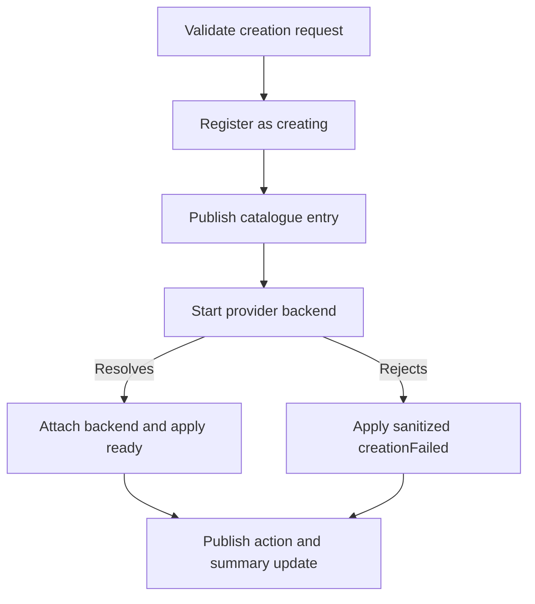
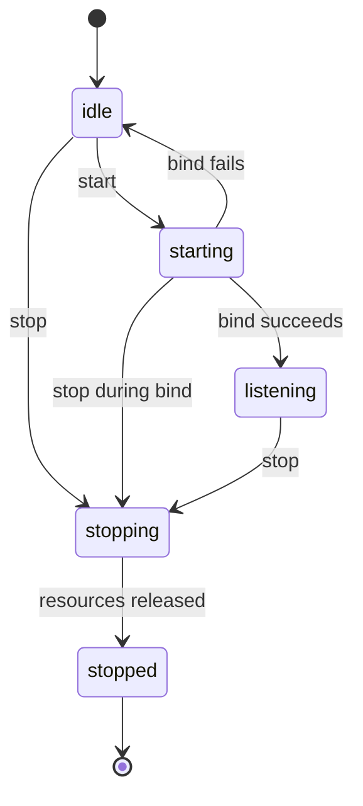

# Runtime Lifecycles

The session factory owns readiness and attached backends. The WebSocket server
owns the listener and connections. The composed host supplies a shared sequence
allocator and coordinates cleanup.

## Session lifecycle

A session starts in `lifecycle: "creating"` and settles through the protocol
reducer:

Invariants:

- `applySessionAction` is the **only** mutation path; it applies the protocol
  reducer, advances `modifiedAt`, and stamps `serverSeq` from the **host-shared
  allocator** (never from the record).
- The backend starts **last**, so a startup failure leaves an inspectable,
  registered session rather than a half-registered one.
- Failure detail is sanitized: only a deliberate `SessionStartError` becomes
  client-visible; all else collapses to the generic `sessionStartFailed`
  payload.

### Disposal races

`SessionsFactory.dispose()`:

1. Flips to shutting down **synchronously**, so `createSession` called while
   disposal is in flight rejects with `SessionsDisposingError` (never registers
   after the boundary).
2. Clears the registry and listeners, then releases every **attached** backend,
   collecting failures.
3. A backend **still starting** is not awaited (a non-cooperative provider
   cannot be cancelled). When it resolves, `startBackend` sees the registry no
   longer holds its record and releases the backend **detached**, reporting a
   sanitized `lateBackendDisposeFailed` diagnostic and publishing nothing.
4. Concurrent/repeated `dispose()` calls share one completion
   (single-flight). A reused factory cleans again on a later `dispose()`.
5. Failures are collected into an `AggregateError`; every backend is still
   attempted.

This is why a late backend from an older record can never attach to a reused
URI.

## Action sequence

The host shares a monotonic `serverSeq` allocator across its session and channel
producers. A connection can see gaps when an action goes to other subscribers
or falls outside its authority. Native snapshots give the associated cursor as
`fromSeq`.

- The allocator **orders** actions; it does not by itself provide reconnect or
  replay safety.
- Catalogue notifications are not actions and never consume the sequence.
- Snapshots need the sequence **current at snapshot time**; the allocator only
  mints the next value, so a host must track the current value separately.

## WebSocket server lifecycle

- **Single-flight start:** concurrent `start()` calls share one bind; a bind
  failure returns to `idle` so a later `start()` retries.
- **Terminal once stopping:** `stop()` enters `stopping` **synchronously**,
  before any in-flight bind settles, so a late `listening` callback can never
  restore `listening`. A start that races a stop rejects and leaves no listener.
- **Heartbeat:** every `30s`, a socket that has not `pong`ed since the previous
  ping is terminated. The timer is cleared on shutdown.
- **Bounded shutdown:** clients get up to `shutdownTimeoutMs` (default `5000`)
  to close; remaining sockets and HTTP connections are force-closed, and
  `stop()` still awaits confirmed local release. `stop()` rejects only if a
  forced close itself throws.
- **A permanent HTTP error listener** absorbs late server-level errors so they
  cannot crash the process.
- **Authentication precedes AHP dispatch.** Hosts using `security` or
  `agentWork` require a principal before creating the connection context.
  Missing or invalid credentials close the socket with `1008`. An
  authentication error closes it with `1011`. The transport pauses frames
  during setup and resumes them for an accepted connection.
- **Transport capacity is finite.** Connection and setup slots are reserved
  before upgrade. The transport bounds queued input and local pending output
  per socket, and tracks deferred requests across the listener. Setup and
  deferred slots remain charged until their promises settle.

## Connection framing

Per socket: text frames are parsed and dispatched; a malformed frame answers a
parse error, a shape-invalid message answers invalid-request (with its id
recovered when possible), and binary frames close the connection (`1003`). The
own-property dispatch guard means inherited members such as `toString` are not
reachable as methods.

## Agent presence and work lifecycle

- `createSession` on an authenticated connection binds the live session URI to
  that principal. A different principal cannot rebind or dispose it.
- `disposeSession` checks ownership first, then dependent work. A work conflict
  leaves the session, its owner binding, and all work rows intact.
- Agent registration is durable; presence is not. Closing a connection releases
  only that connection's binding, and a late close cannot remove a newer
  generation.
- A work lease has a token and a repository-owned deadline. PostgreSQL checks
  that deadline using its own clock. With presence gone, the lease still expires
  on schedule and eligible workers can reclaim it with a new token and attempt.
- Host shutdown rejects new operations and begins protected session
  cancellation synchronously. It stops the transport, disposes the binding,
  waits for the bounded tool drain and owned session cleanup, and releases
  the optional database pool. Every stop caller awaits the same completion or
  aggregate failure. Unresolved remote work can remain draining.

## Gotchas

- Disposal rejects *new* work while in flight; plan for `SessionsDisposingError`.
- Late backends are detached and surfaced only through `onDiagnostic`; they
  never appear as a published action.
- Never allocate a session sequence outside the injected allocator.
- `start()` after shutdown rejects; do not treat the server as restartable.

## Related Documentation

- [`../../src/sessions/README.md`](../../src/sessions/README.md)
- [`../../src/websocket/README.md`](../../src/websocket/README.md)
- [Agent work lifecycle](../architecture/agent-task-lifecycle.md)
- [Documentation index](../README.md)
