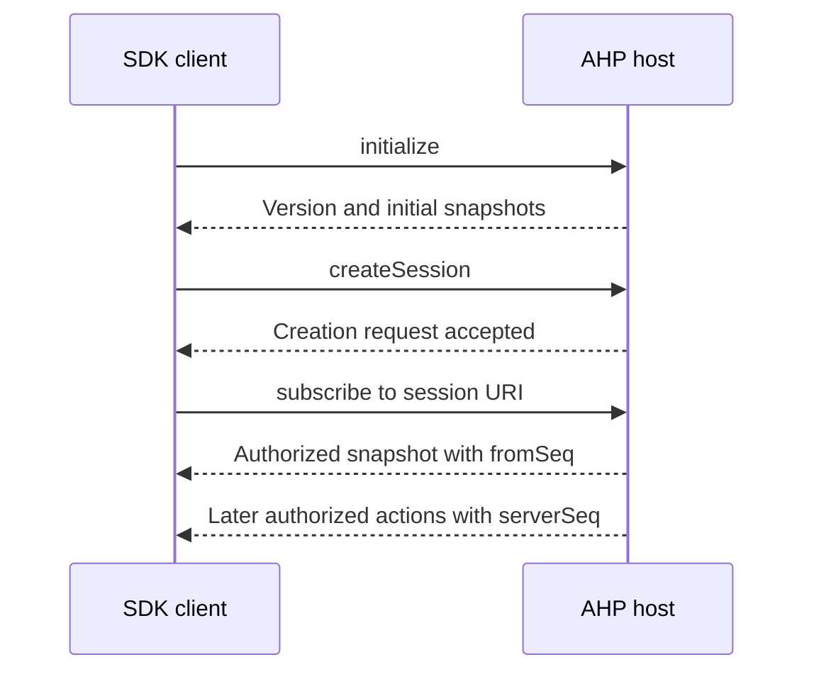

# AHP Wire Contract

How this repository stays faithful to the pinned protocol package,
`@microsoft/agent-host-protocol@1.0.0`, without duplicating or drifting from it.
These rules are why several modules look the way they do; read this before
changing a schema, a protocol literal, or the error surface.

## Single source of truth

The protocol package is authoritative. Local code mirrors and pins, it does not
redeclare:

- JSON-RPC message schemas in
  [`src/jsonrpc/types.ts`](../../src/jsonrpc/types.ts) are asserted against the
  protocol's own message types.
- `createSession` params in
  [`src/sessions/createSession/types.ts`](../../src/sessions/createSession/types.ts)
  are asserted against the protocol's `CreateSessionParams`.
- Error codes come from the package's `JsonRpcErrorCodes` / `AhpErrorCodes`.

Conformance is enforced in two directions:

1. **Compile time** — type assertions fail the build when a protocol member
   stops fitting, or when the protocol adds a member we have not modeled.
2. **Runtime** — fixtures typed with the protocol types are parsed with our
   schemas in [`src/tests/jsonrpc.test.ts`](../../src/tests/jsonrpc.test.ts) and
   [`src/tests/sessions/compliance.test.ts`](../../src/tests/sessions/compliance.test.ts).

If the protocol moves, prefer updating the pin and the mirrors over loosening a
schema.

## Shape before validation

A frame's kind is decided by its members **before** any member is validated.
This ordering is required: validating a request against a stripping notification
schema would remove its `id` and misclassify it. In
[`src/jsonrpc/types.ts`](../../src/jsonrpc/types.ts) a message is shaped first,
then validated against the matching branch.

Unknown additive members are discarded rather than rejected, so a compatible
protocol extension cannot invalidate an otherwise valid message. Known members
stay strictly typed.

## Owned errors and the allowlist

A capability reports a wire error by throwing an
[`RpcError`](../../src/jsonrpc/helpers.ts). The transport trusts it by
`instanceof` and preserves its `code` only when the code is in
`JSONRPC_PUBLIC_ERROR_CODES` (JSON-RPC codes plus AHP codes). Consequences:

- An arbitrary thrown object that merely carries a numeric `code` is not
  trusted; it becomes `-32603 Internal error`.
- An `RpcError` with a non-allowlisted code also collapses to internal error.
- A `ZodError` is mapped to `-32602 Invalid params`.
- Handler failures on a **notification** have no reply channel and are dropped.

See [`src/websocket/helpers/connection.ts`](../../src/websocket/helpers/connection.ts)
for the exact mapping.

## Mirrored `const enum` literals

The protocol package declares discriminants (`SessionLifecycle`,
`SessionStatus`, `ActionType`, ...) as ambient `const enum`s. This project sets
`verbatimModuleSyntax: true`, under which ambient const enum members cannot be
read as values (TS2748).

[`src/sessions/constants.ts`](../../src/sessions/constants.ts) therefore mirrors
the values the server assigns. Each mirror is **pinned to the protocol type**
(so a renamed member fails type checking) and compared against the package's
runtime enum objects by
[`src/tests/sessions/compliance.test.ts`](../../src/tests/sessions/compliance.test.ts)
(so a changed value fails at test time). The file-scoped
`@typescript-eslint/no-unsafe-enum-assignment` disable exists for exactly this
assertion; do not widen it.

## Sequence and channel rules

- The host allocates action sequence values in order across its sessions and
  channels. A recipient can see gaps when intervening actions are outside its
  subscriptions or current authority.
- Catalogue notifications (`root/sessionAdded`, `root/sessionSummaryChanged`)
  target `ahp-root://` and **never** consume the action sequence.
- Action envelopes target `ahp-session:/<id>` and carry the allocated
  `serverSeq`.
- `initialize`/`subscribe` snapshots need the sequence current at snapshot time;
  the allocator mints the next value only, so a host must track the current
  sequence. The snapshot cursor is `fromSeq`. See
  [runtime lifecycles](runtime-lifecycles.md#action-sequence).

The order of subscription and backend readiness varies. A client can observe
`ready` in the subscription snapshot or in a later action. Private tool replies
and lifecycle events use the tool extension instead of the native reducer.

Durable protected hosts can configure `nativeWrites.admit` for native
`dispatchAction` title, read and archive changes, and for `disposeSession`.
The host supplies the verified actor, exact session incarnation and validated
command at admission. Title, read and archive changes require a ready session.
An authorized caller can retire a published session whose provider failed to
start. A subscribed SDK client receives the accepted action
envelope after the state commit, through its existing protected view. Cursor
consent alone grants no mutation authority.

## Application tool extension

Trusted canonical typed session snapshots carry the server-authored contract manifest
under `_meta["x-ahp-application"]`. This does not extend AHP's top-level state or
claim the host implements `serverTools`. Client advertisements use the standard
`session/activeClientSet` action with exact revision metadata under each tool's
`_meta["x-ahp-tool-contract"]`; full schemas survive parsing for comparison.

The public host negotiates project-owned tool protocol v2 separately from native
AHP 1.0.0. `x-ahp/tools/assigned`, `advertise`, `dispatch`, `status`, `resume`, and
`cancel` use exact private envelopes. Remote execution uses correlated host
`invoke` and client `complete` notifications. Host-registered actions use the same
dispatcher and settle locally. The [tool client adapter](../../src/toolClient/README.md)
owns this exchange. The compatibility kernel's unversioned `call` stays private.

A separate `x-ahp/tools/extensions` request preserves the base v2 reply shape.
Negotiated `manage` carries propose, approve and publish operations. Negotiated
`artifact` carries authorized exact artifact metadata and bounded bytes in one
private response. The host keeps activation as an in-process session operation.

## Protected native read projection

Explicit host `protectedViews` configuration admits resource-read policies from
the canonical registry/compiler. Selected discover/reveal plus actual bindings
and mandatory constraints grants resource content, including authored text; it
does not grant tool execution. The transport separately requires global-sequence
consent. Initial subscription batches are atomic, and final reply/send guards
recheck current authority, resource incarnation and subscription ownership.

Protected snapshots/actions empty structured active-client/server tools and
application metadata. Root provider catalogue is empty without separate authority;
session counts and list pages are filtered before pagination. List cursors are
opaque, recipient/basis-bound and short lived. Private proof stamps and canonical
basis refs never appear in the response. Canonical state remains unchanged.

Projected native actions retain actual serverSeq/fromSeq semantics. The pinned SDK
reducers are exercised for session metadata, active clients, server tools and root
counts. Unsupported transitions and permission-only membership changes close the
view; canonical additions use genuine catalogue/count events. No new native version,
replacement sequence or guessed resnapshot action is introduced. Advertisers
receive exact acknowledgements through the negotiated private tool API.

## Authenticated agent/work extension

The optional extension is also namespaced and versioned. Every method is a
request using `version: 1`:

- `x-ahp/agents/register`, `renew`, `unregister` — durable registration plus a
  live in-memory presence binding.
- `x-ahp/work/get` — an authorized work view with the lease holder and token
  omitted, or `work: null` for an absent or inaccessible item.

Through P2, an initialized client receives JSON-RPC `MethodNotFound` for
`x-ahp/work/submit`, `claim`, `renew`, `complete`, `fail`, `cancel`, and
`updateData`. This also applies to the session owner and registered workers.
The host derives the principal for work reads from the authenticated connection.

Registration text passes the application's
portable-text profile before reaching a repository. It rejects NUL and unpaired
UTF-16 surrogates so accepted values are consistent across storage adapters;
this is application policy, not a claim that JSON itself cannot represent those
values. The profile does not replace request schemas, authorization, or payload
size checks. See the [persistence contract](../../src/persistence/README.md#portable-text-profile-v1).

An agent/work host using static tokens requires
`Authorization: Bearer <token>` on the upgrade. The resolved subject attaches
before AHP dispatch. Missing or unknown credentials close the socket with
`1008`. Supported native initialization independently requires trusted
global-sequence consent, and protected reads require resource-view configuration.
`initialize.clientId` is never identity. See
[`../architecture/agent-task-lifecycle.md`](../architecture/agent-task-lifecycle.md).

## Gotchas

- Do not read a const enum member directly; add a pinned mirror instead.
- Do not reorder shaping and validation.
- Do not reject unknown additive members; discard them.
- Do not surface an arbitrary code; add it to the allowlist set only if the
  protocol defines it.

## Related Documentation

- [`../../src/jsonrpc/README.md`](../../src/jsonrpc/README.md)
- [`../../src/websocket/README.md`](../../src/websocket/README.md)
- [Application walkthrough with SDK and WebSocket](../guides/advanced.md)
- [Documentation index](../README.md)
